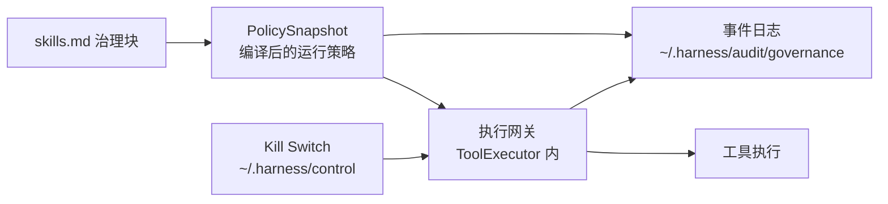

# HKMA Agentic AI 治理对齐方案 · P0

> 范围：`packages/sdk` 单 Agent 内核 + 本项目桌面客户端
> 部署前提：**桌面单机；客户端每次启动同步技能源码**
> 依据：HKMA《Discussion Paper on Agentic A.I. Governance in the Banking Sector》（2026-11，非约束性讨论文件）
> 原则：讨论文件不是监管条文；关键裁决由确定性代码完成，LLM 不参与放行或阻断。

---

## 1. 目标与范围

### 1.1 唯一目标

> **抓住 AI 可能“错误执行”和“偏离业务意图”的行为。**

治理链只有四段，每段都有明确的责任人：

| 段 | 谁做 | 交付物 |
|---|---|---|
| 登记 | 开发同事 | `skills.md` 治理块：业务意图、责任人、可用工具、业务参数约束、必经步骤、限额 |
| 约束 | 机器 | 执行网关：白名单 + 能力分级 + 业务参数硬校验 + 必经步骤推进 |
| 干预 | 机器 + 人 | Kill Switch：客户端内停 / 本机外停 |
| 留痕 | 机器 | 结构化事件日志，`run_id` 贯穿 |

### 1.2 P0 范围

| 能力 | 说明 |
|---|---|
| 治理声明 | `skills.md` 治理块 + 严格校验，strict 下必填 |
| 执行网关 | 所有工具调用（含 MCP、自定义）单入口、参数终态校验 |
| 必经步骤 | 步骤图 + 推进判定，跳步被拒 |
| 业务参数约束 | 开发随工具一起声明，网关确定性求值 |
| 限额与异常信号 | 调用/速率/token 限额 + 连续拒绝、跳步等信号与升级 |
| Kill Switch | 桌面文件 + CLI + UI，`active/suspended/revoked` |
| 事件日志 | 结构化 JSONL，`run_id` 贯穿，可复盘 |

### 1.3 明确不在 P0

| 项 | 理由 |
|---|---|
| 材料性评分矩阵（Reach/Oversight） | 登记可信；改为开发声明的 `material` 布尔标签 |
| Registry 审批工作流 / `approved` 状态 | 批准发生在 PR 与发布流程，运行时重复签一遍是冗余 |
| 环境（prod/staging）交叉校验 | 桌面单机场景无收益 |
| 全局作用域、`throttled` 状态 | 桌面场景不需要，避免状态机复杂度 |
| 哈希链、HMAC、外部锚定 | 单机复盘已足够；避免过度设计 |
| Redis / HTTP 控制面、多副本 | 部署前提是单机 |
| 模型声明步骤、语义 LLM 判定 | LLM 不参与放行/阻断，概率控制不进 P0 |
| KYA、组件血缘图、监管报送 | 与主目标无直接关系，见第 18 节 |
| 多 Agent 治理扩展 | P0 只做单 Agent |

---

## 2. 治理对象与信任模型

### 2.1 治理对象

治理对象是**技能（Skill）**：一个技能 = 一份 `skills.md`（含治理块）+ 一组工具。治理块描述这个 Agent 是谁批准的、允许做什么、按什么步骤做、超限怎么办。

### 2.2 信任模型

三条前提决定了设计取舍：

| 前提 | 设计后果 |
|---|---|
| 登记由开发同事设计，视为准确 | 治理元数据不需要交叉校验、不需要审批流、不需要防篡改；治理块是**授权书**，不是自证材料 |
| 客户端每次启动同步技能源码 | 治理块与被执行的正文同源同版本；运行时无需校验正文哈希；变更随下次启动生效 |
| 桌面单机 | 不需要分布式一致、Redis、外部锚定、远程控制面 |

由此得出核心原则：

> **信任登记，怀疑执行。** 风险来自 AI 的行为选择，不来自开发者的填表动机。

因此 P0 的全部力气投在**执行路径**上：AI 选了什么工具、传了什么参数、跳过了什么步骤、跑了多久、出了事能不能停。

---

## 3. 现状与差距

| 能力 | 现状 | 差距 |
|---|---|---|
| 工具执行入口 | `ToolExecutor.execute()`（`core/agent_loop.py:1552`） | 校验分散在 Hook 中，可被跳过 |
| 工具闸门 | `ToolGateHook`（`core/hooks.py:543`） | `execute_hooks` 在首个非 CONTINUE 处返回（`core/hooks.py:203-208`），`MODIFY_ARGS`（`core/agent_loop.py:1516`）可改写参数 → **闸门可被顺序绕过** |
| 权限范围 | `PermissionSet` 默认 workspace 沙箱（`core/agent_loop.py:1431`） | 缺“业务允许什么”的白名单与约束 |
| 业务参数约束 | 无 | AI 可传“类型合法但政策违规”的值（金额、客户、枚举） |
| 必经步骤 | 无 | **跳步/乱序无法发现**（如跳过 AML 直接出报告） |
| 限额与信号 | `CostController` / `StepBudget` 有次数与 token 限制 | 缺“连续拒绝 / 连续失败 / 跳步”等行为信号 |
| 中断 | `interrupt()` 进程内有效 | 不可跨进程、无持久状态、无留痕 |
| 输出把关 | `DeterministicGate` / `Reconciler` | 可用，原样保留 |
| 注入防护 | `PromptInjectionDetector` + 工具输出脱敏 | 原样保留 |

---

## 4. P0 架构

### 4.1 组件



### 4.2 运行数据流

1. **同步**：客户端启动同步技能源码（含治理块）。
2. **编译**：解析治理块 → `PolicySnapshot`（白名单、约束、步骤图、限额、审批项、material 标记）。
3. **执行**：每次工具调用在 `ToolExecutor` 内按统一流水线校验，校验对象是**参数最终态**。
4. **推进**：工具调用驱动步骤状态机；跳步被拒并记录。
5. **监控**：限额与行为信号计数；超限降级或升级人工复核。
6. **干预**：Kill Switch 在检查点读取状态；命中即中断或拒绝。
7. **留痕**：全过程写入结构化事件日志。

### 4.3 模式开关

| 模式 | 行为 |
|---|---|
| `strict=False`（默认） | 治理不激活，行为与现状完全一致 |
| `strict=True` | 治理全部生效 |
| `HARNESS_REQUIRE_STRICT=1` | 环境变量强制开启（已有机制） |

治理块在 strict 下为**硬门槛**：缺失或校验不过 → 拒绝注册与执行。

兼容策略：**不做旧格式 / 旧 API 兼容**。strict 下没有治理块的技能直接拒绝。

---

## 5. 治理声明

### 5.1 位置与发现

- **唯一位置**：`skills.md` frontmatter 的 `governance` 块。不引入 `governance.yaml` 或数据库主存，避免双写与漂移。
- 发现顺序：显式 `governance.record_path` → 当前工作目录 `skills.md` → 拒绝（strict）。
- 客户端场景：同步后的技能目录内 `skills.md`。
- 治理块与正文同源；正文改动随下次同步生效，事件日志记录 `agent_version` 与技能版本。

### 5.2 字段

```yaml
---
name: credit-paper-assembler
description: 组装信贷报告初稿
governance:
  agent_id: credit-paper-assembler
  version: 1.2.0
  business_intent: 从核心系统与授权外部源组装信贷报告初稿，供信用分析师复核
  owners:
    accountable: Head of Credit Risk
    technical: DevOps Lead A
  material: true                       # 开发声明；只影响限额严格度、事件完整度、失败复核
  tools:
    - name: core_banking_api:read_only
      capability: read
    - name: internal_doc_store:search
      capability: read
    - name: aml_screening:run
      capability: write
    - name: report_writer:draft
      capability: write
  workflow:
    - id: collect_data
      tools: [core_banking_api:read_only, internal_doc_store:search]
      complete: all                    # all | any | <tool_name>（默认 all）
    - id: aml_check
      tools: [aml_screening:run]
      complete: aml_screening:run
    - id: draft_report
      tools: [report_writer:draft]
  allowed_paths: ["/data/credit"]      # 可选；与 PermissionSet 取交集
  allowed_hosts: ["core-bank.internal"] # 可选
  limits:
    max_tool_calls_per_run: 50
    max_calls_per_minute: 20
    max_tokens_per_run: 200000
  approval_required_for: [draft_report] # 只对 write 类生效
  intervention:
    kill_switch: file
    fallback: manual_credit_paper
---
```

### 5.3 校验规则（strict 下 fail-closed）

**必填**：`agent_id`、`version`、`business_intent`、`owners.accountable`、`owners.technical`、`tools`、`limits`。

**可选**：`allowed_paths`、`allowed_hosts`、`material`、`workflow`、`approval_required_for`、`intervention`。

**规则**：

1. `tools[].name` 必须存在于工具注册表；`capability` 必填，取值 `read / write / payment / destructive`。
2. 声明 `workflow` 时：
   - 每个 step 至少绑定一个工具；每个工具默认只属于一个 step；
   - 跨步骤共用的工具显式 `shared: true`，且不作为任何 step 的完成证据；
   - 未被任何 step 引用的工具必须标 `shared: true`（可用但不作为完成证据），否则视为配置错误；
   - `complete` 取 `all`（默认）/ `any` / `<tool_name>`。
3. `approval_required_for` 只能引用已声明 step 或工具；不能用于 `payment` / `destructive` 工具（这两类强制审批，见 6.3）。
4. `material` 缺省 `false`，为开发声明的布尔标签，不参与审批判定。
5. 未知字段拒绝（防拼写错误绕过）。

---

## 6. 能力一：执行网关（约束）

### 6.1 单入口与参数终态

所有工具调用（含 MCP、自定义）都经 `ToolExecutor.execute()`，且校验发生在**参数最终态**之后。

原因：现存的 Hook 机制允许 `MODIFY_ARGS` 在校验之后改写参数（`core/agent_loop.py:1516`），且 `execute_hooks` 在首个非 CONTINUE 结果处直接返回（`core/hooks.py:203-208`）——以 Hook 形式实现的闸门可能被跳过，或放行改写前的参数。

因此：

- 业务校验一律进 executor 内的统一流水线，不放在 Hook。
- `ToolGateHook` 的沙箱与文件校验逻辑迁入流水线；Hook 仅保留给可选扩展，不构成治理控制点。
- side-effect 闸门（`core/agent_loop.py:1522`）与流水线合并，避免两套规则不一致。

### 6.2 校验流水线

```
1. 治理一致性   agent_id / version / skill_version 与 PolicySnapshot 一致
2. 工具白名单   工具已登记且在治理块 tools 列表内
3. 能力声明     capability 已声明；MCP 工具按治理块声明
4. 步骤推进     见第 7 节
5. 业务约束     见 6.4
6. 权限范围     路径 / 主机 / 命令（PermissionSet + 治理块 allowed_paths / allowed_hosts）
7. 限额         见第 8 节
8. 审批关卡     按 capability 定档，见 6.3
9. 事件记录     allow / deny + 原因
10. 执行
```

### 6.3 能力分级与校验深度

| capability | 典型工具 | 校验深度 | 人工审批 |
|---|---|---|---|
| `read` | 查询、检索、读文件 | 白名单 + 路径范围 + 速率 | 默认不需要 |
| `write` | 写文件、调用内部写接口 | 以上 + 业务参数约束 + 步骤绑定 | 治理块 `approval_required_for` 声明时需要 |
| `payment` | 支付、转账、额度调整 | 以上 + 金额上限 + 不可逆提示 | **强制需要，不可关闭** |
| `destructive` | 删除、批量变更 | 以上 + 事后事件 + 建议可回退 | **强制需要，不可关闭** |

- 自研工具在代码里声明 `capability` 与 `constraints`（6.4）；MCP 工具在治理块声明，沿用现有工具命名 `mcp_<server>_<tool>`。
- 未声明 capability 的工具：strict 下拒绝注册，不保留 `unknown` 后门。
- `approval_required_for` 匹配语义：填 **step id** → 该 step 内所有 `write` 类工具需审批；填 **工具名** → 该工具需审批。
- **审批触发条件由 capability 决定，与 `material` 无关**：
  - `payment` / `destructive` → 无条件人工审批，治理块不能关闭；
  - `write` → 治理块显式声明才需审批；
  - `read` → 默认不审批。
- `material` 只影响三件事：限额更严、事件更全、失败时进 `ReviewQueue` 复核；核心约束恒定生效。

### 6.4 业务参数约束（开发随工具一起声明）

约束是工具的内在属性，与工具定义放在一起（自研工具在代码里，MCP 工具在治理块），由网关确定性求值：

```python
@dataclass
class ToolConstraints:
    required_fields: list[str] = field(default_factory=list)
    numeric_ranges: dict[str, tuple[float, float]] = field(default_factory=dict)
    allowed_values: dict[str, list] = field(default_factory=dict)
    amount_field: str | None = None
    max_amount: float | None = None
    min_amount: float | None = None
    max_calls_per_run: int | None = None
    deny_paths: list[str] = field(default_factory=list)
```

求值规则：

- 任一约束不满足 → 拒绝该次调用，写 `constraint_violation` 事件（含字段名与实际值摘要）。
- 约束求值出错（类型不符、解析失败）→ fail-closed 拒绝。
- 约束与工具 Schema 冲突 → 注册期报错，不留到运行期。

典型约束：

| 场景 | 约束 |
|---|---|
| 放款 / 转账 | `amount_field=amount`、`max_amount=1_000_000`、`allowed_values={currency: [CNY, USD]}` |
| 查询客户 | `allowed_values={customer_tier: [A, B, C]}`、`numeric_ranges={lookback_days: (1, 365)}` |
| 写文件 | `deny_paths=["/etc", "~/.ssh", "**/.git/**"]` |

### 6.5 失败语义

| 情况 | 行为 |
|---|---|
| 未登记 / 未授权工具 | 拒绝 + 事件 |
| capability 未声明 | 拒绝注册 |
| 跳步（越过未完成 step） | 拒绝该次调用 + `step_violation` + 计数 |
| 步骤重入（已完成 step 再调用） | 允许执行，记 `step_reentry` 信号（超阈值告警） |
| 业务约束不满足 | 拒绝 + `constraint_violation` |
| 路径 / 主机越界 | 拒绝 |
| 限额超限 | 拒绝或降级（material 直接拒绝） |
| `payment` / `destructive` 未审批 | 拒绝 |
| `write` 命中 `approval_required_for` 且未审批 | 拒绝 |
| 审批超时 | 拒绝 |
| Kill Switch 命中 | 拒绝 / 中断 run |

---

## 7. 能力二：必经步骤（抓偏离业务意图）

### 7.1 步骤图

治理块按顺序声明步骤，step 拥有自己的工具集合：

```yaml
workflow:
  - id: collect_data
    tools: [core_banking_api:read_only, internal_doc_store:search]
    complete: all              # all | any | <tool_name>（默认 all）
  - id: aml_check
    tools: [aml_screening:run]
    complete: aml_screening:run
  - id: draft_report
    tools: [report_writer:draft]
```

完成判定：

| `complete` | 含义 |
|---|---|
| `all`（默认） | 该 step 下所有工具都至少成功调用过一次 |
| `any` | 任一工具成功即完成 |
| `<tool_name>` | 指定工具成功即完成，其余工具为辅助调用，不影响完成 |

步内调用顺序不限；跨 step 必须按声明顺序推进。

### 7.2 推进与判定

每次工具调用：

1. 工具必须属于某个已声明 step；未绑定 → 拒绝。
2. 目标 step 之前若存在未完成 step → **跳步** → 拒绝 + `step_violation` + 计数。
3. 目标 step 已完成 → **允许重复调用**（补数据、重试），执行后记 `step_reentry` 信号，不阻断。
4. 目标 step 是当前 step → 正常执行。
5. 工具执行成功后按 `complete` 规则推进完成状态。

示例（`collect_data → aml_check → draft_report`）：

- AI 未调用 `aml_screening:run` 就调用 `report_writer:draft` → 该次调用被拒绝，记录 `step_violation`（含被跳过的 step 名）。
- AML 已完成后再次调用 AML 查证 → 允许执行，记录 `step_reentry`。

### 7.3 为什么用开发声明的绑定，而不是让模型声明当前步骤

- 模型声明不可靠（漏写、漂移），会把 P0 变成概率控制。
- 工具与步骤的绑定由开发声明，机器可确定性判定，是确定性闸门而非模型自述。
- 代价：步骤必须能被工具调用刻画。纯推理步骤不设为独立 step，或由一个显式工具表达。

---

## 8. 能力三：限额与异常信号

### 8.1 限额

| 限额 | 含义 |
|---|---|
| `max_tool_calls_per_run` | 单次 run 工具调用总数上限 |
| `max_calls_per_minute` | 滑动窗口速率上限 |
| `max_tokens_per_run` | 单次 run token 上限（复用 `CostController` / `StepBudget`，补齐治理侧限额） |

### 8.2 行为信号

| 信号 | 含义 | 默认动作 |
|---|---|---|
| `consecutive_denials` | 连续被网关拒绝 | 计数；达阈值升级人工复核 |
| `consecutive_failures` | 连续工具失败 | 沿用熔断思路，降级或中止 |
| `step_violations` | 跳步尝试 | 计数；达阈值自动 suspend |
| `step_reentry` | 已完成 step 被重复调用 | 计数；达阈值告警 |
| `same_args_repeat` | 同参数重复调用 | 复用 `CircuitBreaker` |
| `out_of_scope_attempts` | 反复尝试未登记工具 | 计数；达阈值自动 suspend + 复核 |

阈值取安全默认值，可在治理块覆盖。语义信号（由 LLM 判断“是否偏离意图”）不在 P0：LLM 不参与放行与阻断。

---

## 9. 能力四：Kill Switch（干预）

### 9.1 状态与存储

桌面单机，状态文件即可：`~/.harness/control/<agent_id>.json`。

```json
{
  "agent_id": "credit-paper-assembler",
  "state": "suspended",
  "reason": "AML 步骤被跳过",
  "actor": "developer:emp-4096",
  "updated_at": "2026-11-11T10:00:00Z",
  "version": 7
}
```

- 状态三种：`active` / `suspended` / `revoked`。
- 文件不存在即视为 `active`。
- 文件读取失败或内容损坏 → 记录事件，按上次已知状态处理（无记录则 `active`），不阻断客户端。
- 状态写入带 `version`，重复 suspend 幂等。

### 9.2 触发

```bash
harness governance suspend credit-paper-assembler --reason "AML 步骤被跳过" --actor emp-4096
harness governance resume  credit-paper-assembler --reason "已修复并复核" --actor emp-4096
harness governance status  credit-paper-assembler
```

```python
await agent.control.suspend(reason="AML step bypassed", actor="developer:emp-4096")
```

### 9.3 检查点

| 检查点 | 行为 |
|---|---|
| `run()` 开始 | suspended → 直接返回 `INTERRUPTED`，不调 LLM |
| 每次 LLM 调用前 | suspended → 中断 |
| 每次工具执行前 | suspended → 拒绝该工具 |
| 工具 / 审批完成后 | 再检查，防止检查期间被暂停 |

### 9.4 桌面客户端落地

| 层级 | 手段 | 说明 |
|---|---|---|
| L1 客户端内停 | UI 停止按钮 → `control.suspend()` | 同进程，立即生效 |
| L2 本机外停 | CLI 写控制文件 → 客户端在检查点读到 | 不依赖 UI，界面卡住也能停 |

客户端需要：

1. 启动时读控制文件；`suspended` / `revoked` 直接拒绝执行。
2. UI 停止按钮调用 `control.suspend(reason, actor)`；紧急情况可先 `interrupt()`。
3. 退出时把本次 run 标记为 `suspended(reason="client shutdown")`，避免下次启动误判。

### 9.5 撤销与回退

- `revoked`：调用注册的 `on_revoke(agent_id)` 回调（撤销凭证、断开 MCP 与外部连接）；回调失败仍阻断工具调用，并记录事件与告警。
- `suspended` 且声明了 `fallback`：中断后提示走人工或备用流程（SDK 负责记录与回调，业务流程由接入方实现）。

### 9.6 与 `interrupt()` 的关系

`interrupt()` 是进程内快速取消（保留）；Kill Switch 是持久状态，可跨进程、可由 CLI 或 UI 触发、可留痕。两者互补。

### 9.7 边界

- 不能终止正在执行的任意代码：工具执行中只能等返回；危险工具靠短超时与撤销。
- 长 LLM 调用只能在调用前拦。
- 传播延迟取决于检查点频率，最坏约等于一次 LLM 或工具调用时长。

---

## 10. 能力五：结构化事件日志（留痕）

### 10.1 事件模型

写入 `~/.harness/audit/governance/<YYYYMMDD>/<pid>.jsonl`（按日期目录 + 按进程分文件），全部带 `run_id`：

```json
{
  "ts": "2026-11-11T10:00:00.123Z",
  "run_id": "run-uuid",
  "agent_id": "credit-paper-assembler",
  "agent_version": "1.2.0",
  "skill_version": "1.2.0",
  "event": "tool_call",
  "tool": "aml_screening:run",
  "capability": "write",
  "step": "aml_check",
  "decision": "deny",
  "reason": "step_violation: step 'aml_check' not completed",
  "duration_ms": 3
}
```

事件类型：`run_start` / `run_end` / `tool_call` / `constraint_violation` / `step_violation` / `step_reentry` / `signal` / `gate_verdict` / `control_plane` / `approval`。

### 10.2 写入方式

- 同步 append + flush：桌面量小，换取“客户端被强杀也不丢已记事件”；不做异步缓冲队列。
- 按进程分文件：避免客户端多开时多进程写同一文件交错。
- 单行 ≤ 2KB：长内容只存哈希与摘要。
- 与既有 `AuditLogger`（`~/.harness/audit/audit-*.log`）并存不混写：治理事件独立目录，不破坏既有审计查询。

### 10.3 保留与边界

- **是可复盘日志，不是防篡改审计链**：P0 不做哈希链、HMAC、外部锚定。
- 保留 30 天（`audit_retention_days`），按日期目录整体删除；清理动作本身记一条事件。
- 敏感参数不落盘：只记参数哈希与必要摘要。

### 10.4 复盘能力

- 按 `run_id` 还原一次 run 的完整轨迹：调用了什么、被谁拒了什么、哪一步没走。
- 日志与技能源码同机，可对照 `agent_version` 还原当时的治理配置。

---

## 11. 复用与范围外

### 11.1 直接复用（不改行为）

| 能力 | 用途 |
|---|---|
| `DeterministicGate` / `Reconciler` | 交付内容把关、无溯源结论隔离 |
| `PromptInjectionDetector` + `ResultSanitizer` | 输入与外部内容净化 |
| `PermissionSet` / `LightweightSandbox` / `FileInputValidator` | 路径、主机、命令范围 |
| `CostController` / `StepBudget` | token 与调用次数上限 |
| `CircuitBreaker` / `StuckDetector` | 循环级异常 |
| `ReviewQueue` | 人工复核与交付隔离复核 |

### 11.2 范围外

见 1.3。

---

## 12. 实施计划

### P0-1　执行网关与业务约束

1. `Tool.capability` / `Tool.constraints` 与注册期校验。
2. `ToolExecutor` 内统一校验流水线（含沙箱与文件校验迁入）。
3. 治理块解析、`PolicySnapshot` 编译、strict 下必填校验。
4. 白名单、路径与主机范围、审批关卡接入。

**验收**：未登记工具、未声明 capability、越界参数、路径越界一律拒绝；Hook 改写参数后仍以终态参数校验。

### P0-2　必经步骤与限额信号

5. 步骤状态机与推进判定（跳步拒绝、重入放行 + 信号）。
6. 治理限额（run 总次数、速率、token）与信号计数、升级动作。

**验收**：跳过 AML 直接出报告被拒；连续拒绝或跳步达阈值自动 suspend。

### P0-3　Kill Switch、事件日志与客户端接入

7. 控制文件读写、CLI `suspend/resume/status`、四处检查点接入。
8. 事件日志（`~/.harness/audit/governance/<日期>/<pid>.jsonl`，同步 append + flush，`run_id` 贯穿、脱敏、保留）。
9. 桌面客户端：启动检查、UI 停止按钮、退出标记。

**验收**：CLI 暂停后客户端在下一个检查点停止；一次 run 可按 `run_id` 还原轨迹。

---

## 13. 验收标准

`strict=True` 时：

- 无治理块 → 拒绝注册与执行。
- 未登记工具、未声明 capability → 拒绝。
- 业务参数越界（金额 / 枚举 / 范围 / 必填）→ 拒绝并记录。
- 跳步 → 拒绝并记录 `step_violation`。
- 已完成 step 的重复调用 → 允许执行并记录 `step_reentry`，不阻断。
- 路径 / 主机越界 → 拒绝。
- 限额超限 → 拒绝或降级。
- `payment` / `destructive` 未审批 → 拒绝（治理块不可关闭该规则）。
- `write` 命中 `approval_required_for` 且未审批 → 拒绝。
- Kill Switch 命中 → 中断或拒绝；`revoked` 触发撤权回调。
- 任一 run 可按 `run_id` 还原完整轨迹。

`strict=False` 时：现有测试全部通过，行为无变化。

---

## 14. 测试策略（三层）

- **静态**：`ruff`、`mypy`。
- **功能**：
  - 治理块正反例：缺字段、未知字段、capability 缺失、step 未绑定工具、共享工具未标 `shared`。
  - 网关绕过用例：Hook `MODIFY_ARGS` 改写参数后仍按终态校验；MCP 工具走同一路径。
  - 步骤机：跳步、跨步乱序、重入放行、同 step 多工具、`complete` 三种取值。
  - 约束求值：金额、枚举、范围、必填、路径；含类型不符时的 fail-closed。
  - Kill Switch：文件缺失视为 active、损坏文件不阻断、suspend 生效、revoke 回调失败仍阻断。
  - 限额与信号：速率窗口、连续拒绝阈值、跳步阈值自动 suspend。
  - 事件日志：字段完整、`run_id` 贯穿、脱敏、保留期清理。
- **回归**：`strict=False` 全绿；strict 治理用例新增。

---

## 15. 技术规范符合性自检

### 15.1 安全设计（`convention/02-安全规约-设计.md`）

| 维度 | 结论 | 说明 |
|---|---|---|
| 凭证与密钥 | 满足 | 不新增密钥存储；撤权回调由接入方实现；日志不落密钥 |
| 输入校验与防注入 | 满足 | 治理块 Schema 校验；工具参数确定性校验；外部内容走既有注入检测 |
| 最小权限 | 满足 | 工具白名单 + capability 分级 + 路径与主机范围 |
| 依赖安全 | 满足 | 不新增运行时依赖 |
| 输出编码 | 满足 | 事件日志统一 JSON 序列化与转义 |
| 密码学原语 | 满足 | 仅用 SHA-256 做参数与版本哈希；不使用弱算法 |

### 15.2 日志与可观测性（`convention/03-日志与可观测性.md`）

| 维度 | 结论 | 说明 |
|---|---|---|
| 不打敏感信息 | 满足 | 只记参数哈希与摘要；不记密钥与完整 PII |
| 结构化与级别 | 满足 | 统一 JSON 事件；`run_id` 贯穿 |
| 适量 | 满足 | 只在 run、工具、违规、信号点写，不做逐 token 记录 |

### 15.3 并发·资源·幂等（`convention/04-并发·资源·幂等.md`）

| 维度 | 结论 | 说明 |
|---|---|---|
| 资源释放 | 满足 | 文件句柄用上下文管理 |
| 避免竞态 | 满足 | 桌面单进程；步骤状态与限额计数随 run 隔离 |
| 写操作幂等 | 满足 | 控制状态写入带 `version`，重复 suspend 幂等 |
| 重试带退避 | 满足 | 沿用既有错误处理策略；P0 不新增外部依赖调用 |

---

## 16. A–H 防翻车清单映射

| 项 | P0 对应 |
|---|---|
| A 数据主权与可信源 | 治理块为唯一事实源；外部内容按不可信处理 |
| B 边界与权限 | 执行网关 + 白名单 + capability + 路径与主机范围 |
| C 校验过滤网 | 治理块 Schema + 业务参数约束 + 步骤判定 + 既有 gate |
| D 交付对账 | 既有 `DeterministicGate` / `Reconciler` |
| E 韧性 | 限额 + 熔断 + Kill Switch |
| F 可观测 | 事件日志 + `run_id` 贯穿 |
| G 人机协同 | 审批关卡 + `ReviewQueue` |
| H 多 Agent | 非目标 |

---

## 17. 风险与缓解

| 风险 | 缓解 |
|---|---|
| 网关增加延迟 | 策略预编译；约束求值纯本地；事件日志同步单行写入 |
| 约束配置错误导致误拦 | 注册期校验；治理块变更经 PR 评审 |
| 步骤建模不准（一步多工具 / 一工具多步） | `complete` 可选 `all` / `any` / 指定工具；共享工具显式 `shared` |
| 步骤过严导致正常任务被拦 | 先在非 material Agent 灰度，再放开到 material |
| 事件日志增长 | 按日期目录 + 保留期清理 |
| 客户端退出未标记导致下次误判 | 退出时写 `suspended(reason="client shutdown")` |

---

## 18. 后续任务

### 18.1 P1（紧接 P0）

| 任务 | 目的 | 验收 |
|---|---|---|
| 步骤与意图一致性 | 让模型额外声明 `step_id` 并与状态机比对，抓“嘴上说 A、实际做 B”。依赖模型配合，先只告警 | 声明与状态机不一致时产生信号，不阻断 |
| 语义漂移信号 | 轨迹级统计（工具序列异常、意图关键词偏离） | 只产生告警，不参与放行 |
| 本机治理索引 | `~/.harness/governance/index.json`，CLI 列举与查询 | `harness governance list` 可按 agent / 版本查询 |
| Guardrails fail-closed | strict 下安全检测异常改为 fail-closed，可配置 | 检测器异常时 strict 阻断、非 strict 放行 |
| 治理指标 | 拦截率、违规分布、复核积压接入 OTel | 指标可查询 |
| 不可逆操作补偿 | `payment` / `destructive` 提供回滚信息与二次确认 | 支付类工具具备回滚路径 |

### 18.2 P2（更远）

| 任务 | 目的 |
|---|---|
| 远程控制面 | 多实例或服务端部署时引入 Redis / HTTP 控制面客户端（不做服务端） |
| KYA | 外部 Agent 身份、委托人与授权范围验证（入站方向） |
| 组件血缘图 | 模型、工具、数据源、第三方依赖的影响分析 |
| 审计强化 | 哈希链、HMAC、外部锚定（WORM），应对多副本与合规取证要求 |
| 监管报送适配 | 仅导出结构化结果，不做报送系统 |
| 多 Agent 治理 | 编排者与子 Agent 的 material 继承、级联暂停 |

---

## 19. 决策记录

| 议题 | 结论 |
|---|---|
| 部署前提 | 桌面单机；客户端每次启动同步技能源码 |
| 主目标 | 抓 AI 错误执行与偏离业务意图 |
| 信任模型 | 信任登记，怀疑执行 |
| 治理对象 | 技能（`skills.md` + 工具集合） |
| 治理声明位置 | 只放 `skills.md` frontmatter，不引入 `governance.yaml` |
| 治理声明准入 | strict 下硬门槛；strict=False 行为不变 |
| 必经步骤 | P0 必做；step 拥有工具（step→tools），不用模型声明步骤 |
| 步骤完成判定 | `complete: all`（默认）/ `any` / 指定工具；一个工具默认只属于一个 step |
| 步骤重入 | 已完成 step 可重复调用，记 `step_reentry`，不阻断 |
| 业务参数约束 | 开发随工具一起声明，网关确定性求值，fail-closed |
| capability | 未声明即拒绝注册；不保留 `unknown` 后门 |
| 审批触发 | 按 capability 定档：`payment` / `destructive` 强制审批（不可关闭），`write` 由治理块声明，`read` 默认不审批 |
| material | 开发声明的布尔标签，不参与审批判定，只影响限额、事件、复核 |
| 限额与信号 | run 次数、速率、token 限额；连续拒绝、连续失败、跳步、重入、同参重复、越权尝试 |
| Kill Switch | 桌面文件 + CLI + UI；`active` / `suspended` / `revoked`；文件缺失即 active |
| 事件日志 | `~/.harness/audit/governance/<日期>/<pid>.jsonl`，同步 append + flush，`run_id` 贯穿；不做哈希链与锚定 |
| MCP 收口 | 全部 MCP 工具经执行网关；沿用现有工具命名 |
| 兼容策略 | 不做旧格式 / 旧 API 兼容 |
