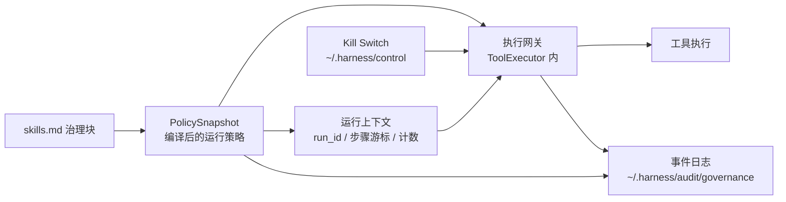

# HKMA Agentic AI 治理对齐方案 · P0

> 范围：`packages/sdk` 单 Agent 内核 + 本项目桌面客户端
> 部署前提：**桌面单机；客户端每次启动同步技能源码**
> 依据：HKMA《Discussion Paper on Agentic A.I. Governance in the Banking Sector》（2026-11，非约束性讨论文件）
> 原则：讨论文件不是监管条文；关键裁决由确定性代码完成，LLM 不参与放行或阻断。
> 步骤语法：**沿用 GitHub Actions（workflow YAML）**，只做减法与三处必要差异——详见 §5（语法基线）与 §8.6（三处差异）。

## 阅读路径

本文分七段，**每段只依赖更早的段**，可按需跳读：

| 段 | 章 | 读它是为了 |
|---|---|---|
| 一 · 为什么与边界 | §1 目标与范围 / §2 信任模型 / §3 现状与差距 | 搞清做什么、不做什么、凭什么信任登记 |
| 二 · 总体设计 | §4 P0 架构 | 理解组件、数据流、模式开关、运行上下文 |
| 三 · 语言与声明 | §5 语法基线（GHA）/ §6 治理声明 | **先学语法，再看字段怎么填** |
| 四 · 机制 | §7 网关 / §8 步骤 / §9 限额 / §10 Kill Switch / §11 留痕 | 执行路径的五段，逐段独立可读 |
| 五 · 汇总与编写 | §12 失败语义总表 / §13 如何准备治理块 | 查失败会怎样；**照着写一份治理块** |
| 六 · 交付 | §14 复用 / §15 实施计划 / §16 验收 / §17 测试 | 落地与验证 |
| 七 · 合规与后续 | §18 自检 / §19 A–H 映射 / §20 风险 / §21 后续 / §22 决策 | 合规论证与决策留痕 |

**两类读者**：
- **要写治理块的开发同事** → §5 → §6 → §13（§13 是操作手册，含九步推导路径与 CLI 工具化）
- **要做实现与验收的同事** → §4 → §6 → §7~§11 → §12 → §15~§17

---

## 1. 目标与范围


### 1.1 唯一目标

> **抓住 AI 可能“错误执行”和“偏离业务意图”的行为。**

治理链只有四段，每段都有明确的责任人：

| 段 | 谁做 | 交付物 |
|---|---|---|
| 登记 | 开发同事 | `skills.md` 治理块：业务意图、责任人、可用工具、业务参数约束、必经步骤、限额 |
| 约束 | 机器 | 执行网关：白名单 + 能力分级 + 业务参数硬校验 + 必经步骤游标判定 |
| 干预 | 机器 + 人 | Kill Switch：客户端内停 / 本机外停 |
| 留痕 | 机器 | 结构化事件日志，`run_id` 贯穿 |

**P0 覆盖边界**（避免过度承诺）：

- ✅ **程序性偏离**——可由确定性规则判定：越权工具、越界参数、跳步、超限、未经审批的副作用调用。
- ❌ **语义性偏离**——"步骤没跳但用错了业务含义"，需要语义判定，不在 P0（见 §1.3）。
- ❌ **结果性偏离**——"单次全合规但累积失守"，需要业务结果数据源，不在 P0（见 §1.3）。

### 1.2 P0 范围

| 能力 | 说明 |
|---|---|
| 治理声明 | `skills.md` 治理块 + 严格校验，strict 下必填 |
| 执行网关 | 所有工具调用（含 MCP、自定义）单入口、参数终态校验 |
| 必经步骤 | 线性步骤链 + 游标判定，跳步被拒；支持条件分支（§8） |
| 业务参数约束 | 开发随工具一起声明，网关确定性求值 |
| 限额与异常信号 | 调用/速率/token 限额 + 连续拒绝、跳步等信号与升级 |
| Kill Switch | 桌面文件 + CLI + UI，`active/suspended/revoked` |
| 事件日志 | 结构化 JSONL，`run_id` 贯穿，可复盘 |

### 1.3 明确不在 P0

> **P0 不等于完整对齐。** 下表左侧是 HKMA 讨论文件涉及、但 P0 **不覆盖**的事项。P0 是执行路径上的确定性闸门，不是完整合规结论。

| 项 | 理由 |
|---|---|
| **语义性偏离**（"步骤没跳但业务含义错了"） | 需要语义判定；LLM 不参与放行/阻断，概率控制不进 P0 |
| **结果性偏离**（"单次全合规但累积失守"） | 需要业务结果数据源（高风险标签占比、结案率等），超出 SDK 通用层 |
| **并行分支 / 汇聚（join）语义** | 步骤链为线性；并行需 GHA job 层 `needs`，P0 不引入（见 §8.4） |
| **回退 / 循环**（"审核不通过退回重做"） | 步骤链为线性、无跳转；审核不通过即**失败终点**（见 §8.4） |
| 材料性评分矩阵（Reach/Oversight） | 登记可信；改为开发声明的 `material` 布尔标签 |
| Registry 审批工作流 / `approved` 状态 | 批准发生在 PR 与发布流程，运行时重复签一遍是冗余 |
| 环境（prod/staging）交叉校验 | 桌面单机场景无收益 |
| 全局作用域、`throttled` 状态 | 桌面场景不需要，避免状态机复杂度 |
| 哈希链、HMAC、外部锚定 | 单机复盘已足够；避免过度设计 |
| Redis / HTTP 控制面、多副本 | 部署前提是单机 |
| 模型声明步骤、语义 LLM 判定 | LLM 不参与放行/阻断，概率控制不进 P0 |
| KYA、组件血缘图、监管报送 | 与主目标无直接关系，见第 21 节 |
| 多 Agent 治理扩展 | P0 只做单 Agent |

---

## 2. 治理对象与信任模型


### 2.1 治理对象

治理对象是**技能（Skill）**：一个技能 = 一份 `skills.md`（含治理块）+ 一组工具。治理块描述这个 Agent 是谁批准的、允许做什么、按什么步骤做、超限怎么办。

**每个技能文件各自带一份治理块**；一次 run 可能同时激活多份，多份如何合成见 §6.4。

### 2.2 信任模型

三条前提决定了设计取舍：

| 前提 | 设计后果 |
|---|---|
| 登记由开发同事设计，视为准确 | 治理元数据不需要交叉校验、不需要审批流、不需要防篡改；治理块是**授权书**，不是自证材料 |
| 客户端每次启动同步技能源码 | 治理块与被执行的正文同源同版本；运行时无需校验正文哈希；变更随下次启动生效；**启动同步即为策略重编译边界** |
| 桌面单机 | 不需要分布式一致、Redis、外部锚定、远程控制面 |
| 工具返回值可信（由开发同事实现） | 条件分支的事实源可信；无需对工具输出做签名或交叉校验 |

> **前提①的精确边界**：「视为准确」= **声明的内容属实**（工具行为确如 `capability` 所述、步骤确为业务必经、参数上限确为业务上限）。
> 它**不覆盖覆盖完备性**——"该有的危险工具有没有列进来""必经步骤有没有漏写"无法机器判定，只能靠评审与灰度（§13.3）。
> **有治理块 ≠ 合规**；治理块是授权书的**形式**，内容由签字的人负责（§13）。

由此得出核心原则：

> **信任登记，怀疑执行。** 风险来自 AI 的行为选择，不来自开发者的填表动机。

因此 P0 的全部力气投在**执行路径**上：AI 选了什么工具、传了什么参数、跳过了什么步骤、跑了多久、出了事能不能停。

### 2.3 前提的兑现义务

前提不是背景描述，而是**约束**。每条前提都排除了某些做法，也**要求**某些机制存在，否则该前提不成立。

| 前提 | 前提排除的做法 | 前提要求存在的机制 | 稿内位置 |
|---|---|---|---|
| 登记可信 | 交叉校验、登记审批流、治理块防篡改 | 治理块要有**签发语义**（否则"授权书"名不副实，退化为自证材料） | §6.2 `approved_by` |
| 启动同步 | 运行时正文哈希校验、多写者合并 | 客户端启动时同步技能源码；治理块随源码走，**下次启动生效**；同步是**覆盖式**（不接受本地回写） | §6.1、§15 |
| 桌面单机 | 分布式一致、Redis、远程控制面、外部锚定 | 单机多写者（CLI + 客户端 UI）仍需**原子写**（临时文件 + rename）；控制文件读写不需分布式 CAS | §10.1 |
| 工具返回值可信 | 对工具输出签名、跨系统对账 | 治理相关工具须返回**结构化产出**；产出未产出即判失败（§8.3） | §7.4、§8.3 |

**前提不覆盖的部分**（必须另行设计，不能借前提省掉）：

- **运行期审批**：前提①排除的是"**登记**审批流"，**不排除运行期调用审批**。`payment` / `destructive` 的强制人工审批是执行期的 Human-in-the-loop，与登记无关（见 §7.5）。
- **运行时控制状态**：前提①管的是登记元数据的准确性，不覆盖 Kill Switch 控制文件的可用性（见 §10.1）。
- **多治理块并存**：前提①说信任登记，但没说多份登记如何合并（见 §6.4）。
- **策略选择依据**：前提①说信任登记，但没说"这次 run 用哪份登记"由谁决定（见 §6.4）。

> ⚠️ **"信任登记"不等于"治理元数据是白纸"**。登记的**内容**可信（不校验），但登记的**作用域**（哪份生效、多份怎么合、谁来选）必须由机制确定，否则信任模型有洞。

---

## 3. 现状与差距


| 能力 | 现状 | 差距 |
|---|---|---|
| 工具执行入口 | `ToolExecutor.execute()`（`core/agent_loop.py:1552`） | 校验分散在 Hook 中，可被跳过 |
| 工具闸门 | `ToolGateHook`（`core/hooks.py:543`） | `execute_hooks` 在首个非 CONTINUE 处返回（`core/hooks.py:203-208`），`MODIFY_ARGS`（`core/agent_loop.py:1516`）可改写参数 → **闸门可被顺序绕过** |
| 权限范围 | `PermissionSet` 默认 workspace 沙箱（`core/agent_loop.py:1431`） | 缺"业务允许什么"的白名单与约束 |
| 业务参数约束 | 无 | AI 可传"类型合法但政策违规"的值（金额、客户、枚举） |
| 必经步骤 | 无 | **跳步/乱序无法发现**（如跳过 AML 直接出报告） |
| 条件分支 | 无 | 无法表达"命中才复核"这类业务分支；分支非穷尽时也无从发现 |
| 限额与信号 | `CostController` / `StepBudget` 有次数与 token 限制 | 缺"连续拒绝 / 连续失败 / 跳步"等行为信号 |
| 中断 | `interrupt()` 进程内有效 | 不可跨进程、无持久状态、无留痕 |
| 运行期审批 | 无 | `payment` / `destructive` 无人工审批关卡 |
| 输出把关 | `DeterministicGate` / `Reconciler` | 可用，原样保留 |
| 注入防护 | `PromptInjectionDetector` + 工具输出脱敏 | 原样保留 |

---

## 4. P0 架构


### 4.1 组件



### 4.2 运行数据流

1. **同步**：客户端启动同步技能源码（含治理块），**覆盖式**拉取，不接受本地回写。
2. **编译**：解析治理块 → `PolicySnapshot`（白名单、约束、步骤链、限额、审批项、material 标记）。
3. **绑定**：把 `PolicySnapshot` 绑定到本次 run 的运行上下文（§4.4）。
4. **执行**：每次工具调用在 `ToolExecutor` 内按统一流水线校验，校验对象是**参数最终态**。
5. **推进**：工具调用驱动步骤游标；跳步被拒并记录。
6. **监控**：限额与行为信号计数；超限降级或升级人工复核。
7. **干预**：Kill Switch 在检查点读取状态；命中即中断或拒绝。
8. **留痕**：全过程写入结构化事件日志。

### 4.3 模式开关

治理有两个开关，职责不同，**不要混用**：

| 开关 | 载体 | 作用 | 单独设置的效果 |
|---|---|---|---|
| **启用开关** | `HarnessConfig.strict=True` | **打开**治理 | 治理生效 |
| **断言开关** | `HARNESS_REQUIRE_STRICT=1`（环境变量） | **断言 strict 必须已开** | strict 未开 → **启动即失败**（`RuntimeError`） |

> ⚠️ `HARNESS_REQUIRE_STRICT=1` **不是启用器**。它只是 fail-fast 断言：设了它但 `strict=False`，SDK 在构造时直接抛错拒绝启动，防止有人把已声明为合规场景的部署悄悄降级。**单独设这个环境变量 ≠ 开启治理**，恰恰相反。

完整组合：

| `strict` | `HARNESS_REQUIRE_STRICT` | 结果 |
|---|---|---|
| `False`（默认） | 未设 | 治理不激活，行为与现状完全一致 |
| `True` | 未设 | 治理全部生效 |
| `False` | `=1` | ⚠️ **启动失败**（`RuntimeError`） |
| `True` | `=1` | 治理生效（断言通过） |

**如何打开 `strict`**（P0 需补齐，见 §15）：

| 场景 | 方式 | 状态 |
|---|---|---|
| SDK 代码 | `AgentHarness(config=HarnessConfig(strict=True, ...))` | 已有 |
| SDK 环境变量 | `HARNESS_STRICT=1` → `HarnessConfig.from_env()` 读取 | **需新增**（与既有 `HARNESS_MODEL` 等风格一致） |
| 桌面客户端 | 客户端设置项新增 `strict` 开关 → 传给 `HarnessConfig` | **需新增**（客户端当前恒为 `strict=False`） |

> **部署前提缺口**：桌面客户端是本方案的主部署形态（§10.4 的一整节客户端要求），但客户端今天既不读 `strict`、也没有该设置项——**治理实现完成后，客户端仍然开不起来**。§15 将其列为 P0-1 工作项。

治理块在 strict 下为**硬门槛**：缺失或校验不过 → 拒绝注册与执行。

兼容策略：**不做旧格式 / 旧 API 兼容**。strict 下没有治理块的技能直接拒绝。

> **注意**：`strict` 已在 SDK 中存在（启用既有治理层：确定性闸门 / 共享状态 / 复核队列）。本方案**扩展**其语义：strict 同时要求治理块存在且校验通过。已启用 `strict=True` 的存量部署需先补齐治理块，这是**破坏性变更**，在 §15 列为迁移项。

### 4.4 运行态上下文

`PolicySnapshot` 是**静态**的（编译产物，run 内固定）；**动态**的部分是"走到哪了"。两者必须分离，否则多 run 并发会串状态。

| 项 | 定义 |
|---|---|
| `run_id` | 每次 `run()` 生成一个 UUID。与 `session_id` 并存：`session_id` 标识会话（可跨多次 run），`run_id` 标识单次执行。事件日志以 `run_id` 关联一次执行的完整轨迹 |
| `PolicySnapshot` 绑定 | 快照在**编译期**确定（启动同步时），在**run 上下文**中按 §6.4 的治理身份解析一次，之后 run 内固定不变 |
| 步骤游标 | per-run 实例，记录每个 step 的 `outcome` / `conclusion`（GHA 语义，见 §8） |
| 限额与信号计数 | per-run 实例，随 run 上下文创建与销毁 |
| 生命周期 | run 开始时创建，run 结束时随事件日志落盘；不留跨 run 状态 |

运行上下文的创建与销毁各对应一个事件：run 开始写 `run_start`（携带 `run_id` / `agent_id` / 治理身份），run 结束写 `run_end`（携带 run 结论 `COMPLETED` / `ERROR` / `INTERRUPTED` / `INCOMPLETE`）。这两个事件是**复盘的锚点**——按 `run_id` 还原轨迹时，先定位 `run_start` / `run_end`，中间的 `tool_call_*` 才能归入同一次执行。

**运行上下文如何送达执行路径**：`ToolExecutor` 是每 harness 一个、被多 session 共享的对象，不能在其上挂 per-run 状态。运行上下文随 `ToolContext` 传入（`ToolContext.metadata`），网关在每次调用时从中取出本次 run 的快照绑定与游标。这样 `ToolExecutor.execute()` 仍是**唯一入口**（§7.1），而状态是 per-call 的。

**重编译边界**：**下次启动**。同一 run 内治理块不变；客户端下次启动同步新源码 → 重编译 → 新快照生效（前提②）。这使"变更随下次启动生效"有了确定的技术含义（§2.3）。

---

## 5. 语法基线：GitHub Actions


> **本章的步骤语法与语义直接沿用 GitHub Actions（workflow YAML）。** 开发同事维护治理块时，用的是 GHA 的既有心智模型与既有文档，无需学习新语法；本方案只做**减法**（子集）与**三处必要差异**（§8.6）。
>
> **只借语法与语义，不引依赖**——不引入 GitHub Actions 运行时、不引入 actionlint 依赖，只在本仓库内实现对应的校验器（§15 实施计划）。

### 5.1 沿用的字段与上下文

| GitHub Actions | 本方案 | 说明 |
|---|---|---|
| step 的 `id` | step 的 `id` | 原样；`steps.<id>.outputs.<name>` 的引用锚点 |
| step 的 `if` | step 的 `if` | 原样；GHA 表达式**子集**（§6.3.3） |
| step 的 `timeout-minutes` | step 的 `timeout-minutes` | 原样 |
| step 的 `continue-on-error` | step 的 `continue-on-error` | 原样字段名；语义收窄为只管重入（§6.3.4 规则 22） |
| `steps.<id>.outputs.<name>` | 事实引用 | 原样语法；产出由工具声明（§6.2） |
| `steps.<id>.outcome` / `.conclusion` | 步骤结论 | 原样；取值 `success` / `failure` / `cancelled` / `skipped` |
| 隐含 `success()` 条件 | 步骤链推进规则 | 原样语义：前序失败 → 后续 step 不可达 |
| `if` 不含状态函数时隐式 `success() && cond` | 守卫求值 | 原样语义 |
| 状态函数 `success()` / `failure()` / `always()` / `cancelled()` | 状态函数 | 原样可用 |
| 表达式运算符与函数 | 同名子集 | `== != < <= > >= && \|\| !`；`contains() startsWith() endsWith() format() join() toJSON() fromJSON()` |
| 上下文 `env` | `env` | 原样 |
| 上下文 `steps` | `steps` | 原样（**只含已执行的 step**） |
| 上下文 `github` / `secrets` / `matrix` / `runner` / `needs` / `jobs` / `inputs` / `vars` | **不提供** | 与治理无关，或带副作用（`secrets` / `hashFiles()` 读文件系统＝能力泄漏） |

**GHA 官方文档（供开发查证语义）**：

| 主题 | 链接 |
|---|---|
| workflow 语法总览 | https://docs.github.com/en/actions/writing-workflows/workflow-syntax-for-github-actions |
| 表达式求值 | https://docs.github.com/en/actions/reference/workflows-and-actions/expressions |
| 上下文（`steps` / `env` / `needs` 等） | https://docs.github.com/en/actions/reference/workflows-and-actions/contexts |
| 条件与状态函数 | https://docs.github.com/en/actions/using-jobs/using-conditions-to-control-job-execution |

### 5.2 沿用的关键语义（为什么这些必须一致）

| 语义 | GHA 行为 | 本方案依赖它的原因 |
|---|---|---|
| **前序 step 被跳过不阻断后续**（内层 step） | `skipped` 不算失败，后续 step 照跑 | "AML 未命中 → 人工复核跳过 → 照常出报告"——若跳过会阻断，正常业务流程会被误停 |
| **前序 step 失败阻断后续** | 隐含 `success()` 失效 | "AML 失败 → 报告步骤不可达"——失败必须阻断 |
| **`if` 为假的 step 结论是 `skipped`** | `conclusion = skipped` | 汇聚点据此判断"分支未激活"（§8.5） |
| **`outcome` / `conclusion` 四值** | `success` / `failure` / `cancelled` / `skipped` | 步骤状态可与 GHA 一一对应，便于复盘对照 |
| **产出全为字符串** | `steps.<id>.outputs.<x>` 是 string | 强制 `== 'true'` 写法，避免 GHA 常见的"非空即真"陷阱（§6.3.3 规则 15） |
| **`steps` 上下文只含已执行的 step** | 已 run 的 step 才有 id | 保证"事实还没产生就不会被引用"（§8.3 守卫求值时机） |

### 5.3 减法：P0 不提供的 GHA 能力

| GHA 能力 | 本方案 | 原因 |
|---|---|---|
| job 层 `needs`（DAG 依赖） | ❌ | 步骤链为线性；并行 / 汇聚语义 P0 不支持（§1.3） |
| job 层 `outputs`（映射到 `steps.<id>.outputs`） | ❌ | 内层 step 本就不声明 outputs，本方案由工具产出、步骤自动暴露 |
| `strategy.matrix` / `include` / `exclude` | ❌ | 与治理无关 |
| `runs-on` / `container` / `services` | ❌ | 桌面单机，无 runner 概念 |
| `concurrency` | ❌ | 单机单实例（§10.8） |
| `permissions` / `secrets` / `env`（job 级） | ❌（仅保留 step 级 `env`） | `secrets` 属凭证管理，超出本方案范围 |
| 复用工作流（`workflow_call` / `uses` at job level） | ❌ | 不引依赖 |
| `timeout-minutes` at job 级 / `defaults` | ❌ | 无 job 概念 |

## 6. 治理声明


### 6.1 位置与发现

- **唯一位置**：`skills.md` frontmatter 的 `governance` 块。不引入 `governance.yaml` 或数据库主存，避免双写与漂移。
- **一个技能文件一份治理块**：治理块随技能源码走，由技能发现机制一并加载（不另设全局策略文件）。
- 客户端场景：启动时**覆盖式**同步技能源码到技能目录，治理块随源码一起更新；本地不回写治理块（前提②）。
- 治理块与正文同源；正文改动随下次同步生效，事件日志记录 `agent_version` 与技能版本。

### 6.2 字段

字段分两类：**执行期强制**（网关在运行路径上消费）与**仅登记备查**（供事后追溯与人工复核，不影响放行/阻断）。仅登记备查的字段在 P0 不产生任何执行效力。

> **步骤语法沿用 GitHub Actions（workflow YAML）**：`workflow.steps` 的字段名、`if:` 表达式、`steps.<id>.outputs` 引用、`outcome` / `conclusion` 取值均与 GHA 一致，开发同事无需学习新语法。沿用清单与三处差异见 §5 / §8.6。

```yaml
---
name: credit-paper-assembler
description: 组装信贷报告初稿
governance:
  agent_id: credit-paper-assembler
  version: 1.2.0
  approved_by: "PR #1284 merged by dev-lead-a"   # 签发语义：治理块以 PR 合并为签发动作
  business_intent: 从核心系统与授权外部源组装信贷报告初稿，供信用分析师复核
  owners:
    accountable: Head of Credit Risk
    technical: DevOps Lead A
  material: true                       # 开发声明；只影响限额严格度、事件完整度、失败复核

  # ── 工具契约 ──────────────────────────────────────────
  tools:
    - name: core_banking_api:read_only
      capability: read
      idempotent: true                 # 重复调用无额外副作用
    - name: internal_doc_store:search
      capability: read
      idempotent: true
    - name: aml_screening:run
      capability: write
      idempotent: true
      outputs:                         # 该工具产出的事实（供 if: 引用）
        - name: aml_hit
          from: metadata               # metadata | content_json
          path: aml_hit
    - name: report_writer:draft
      capability: write
      idempotent: false                # 重复调用会产生第二份草稿
    - name: review_submit:post
      capability: write
      idempotent: true
    - name: note_logger
      capability: write
      idempotent: true

  # ── 步骤链 ────────────────────────────────────────────
  workflow:
    shared_tools: [note_logger]         # 可选；任意 step 可调用，但不作为完成证据
    steps:
      - id: collect_data
        tools: [core_banking_api:read_only, internal_doc_store:search]
        complete: all                  # all | any | <tool_name>（默认 all）

      - id: aml_check
        tools: [aml_screening:run]

      - id: manual_review
        if: ${{ steps.aml_check.outputs.aml_hit == 'true' }}
        tools: [review_submit:post]

      - id: draft_report
        tools: [report_writer:draft]
        timeout-minutes: 5

  allowed_paths: ["/data/credit"]       # 可选；与 PermissionSet 取交集
  allowed_hosts: ["core-bank.internal"]  # 可选
  limits:
    max_tool_calls_per_run: 50
    max_calls_per_minute: 20
    max_tokens_per_run: 200000
    approval_timeout_seconds: 300
    signal_thresholds:
      consecutive_denials: 5
      consecutive_failures: 3
      step_violations: 3
      step_reentry: 5
      out_of_scope_attempts: 3
      guard_unresolved: 3
      approval_timeout: 3
      branch_overlap: 1
  approval_required_for: [draft_report] # 只对 write 类生效
  intervention:
    kill_switch: file
    fallback: manual_credit_paper
---
```

**字段强制等级**：

| 字段 | 等级 | P0 消费点 |
|---|---|---|
| `tools[].name` / `capability` | 执行期强制 | §7.2 步骤 2/3 |
| `tools[].idempotent` | 执行期强制 | §8.3 重入判定 |
| `tools[].outputs` | 执行期强制 | §8.2 条件求值 |
| `workflow.steps` | 执行期强制 | §8 游标判定 |
| `allowed_paths` / `allowed_hosts` | 执行期强制 | §7.2 步骤 6 |
| `limits` | 执行期强制 | §9 |
| `approval_required_for` | 执行期强制 | §7.3 / §7.5 |
| `agent_id` / `version` | 执行期强制（一致性校验） | §7.2 步骤 1 |
| `business_intent` | **仅登记备查** | P0 不消费；语义漂移信号在 P1（§21.1） |
| `owners` | **仅登记备查** | 供事后归因（§11） |
| `approved_by` | **仅登记备查** | 签发留痕（前提①） |
| `material` | **仅登记备查** | 只影响限额严格度 / 事件完整度 / 失败复核 |
| `intervention.*` | **仅登记备查** | 检查点与提示语是固定行为，不由该字段驱动 |

> ⚠️ **`business_intent` 目前不产生执行效力。** P0 抓的是**程序性偏离**（跳步、越权、越界）；"步骤没跳但业务含义错了"属语义性偏离，依赖 P1 的语义漂移信号（§21.1）。填了 `business_intent` 不等于意图已被锚定。

### 6.3 校验规则（strict 下 fail-closed）

**必填**：`agent_id`、`version`、`approved_by`、`business_intent`、`owners.accountable`、`owners.technical`、`tools`、`limits`。

**可选**：`allowed_paths`、`allowed_hosts`、`material`、`workflow`、`workflow.shared_tools`、`approval_required_for`、`intervention`；step 级可选 `if` / `complete` / `timeout-minutes` / `continue-on-error`。

####  6.3.1  通用

1. `tools[].name` 必须存在于工具注册表；`capability` 必填，取值 `read / write / payment / destructive`。
2. `tools[].idempotent` 必填（布尔）——重入判定依赖它，不允许缺省猜测。
3. `tools[].outputs[]`：`name` 全局唯一（跨工具）；`from` 取 `metadata` / `content_json`；`path` 为点路径且非空；`from: content_json` 时该工具的结果必须含可解析 JSON（否则其产出恒缺失 → 恒判失败，§8.2）。
4. `material` 缺省 `false`，为开发声明的布尔标签，**不参与审批判定**。
5. `owners` 必须同时含 `accountable` 与 `technical` 且均为非空字符串（责任人缺失即问责链断裂，§19 A–H）。
6. **未知字段拒绝**（防拼写错误绕过）。
7. `approval_required_for` 只能引用已声明 step 或工具；`payment` / `destructive` 的强制审批不可关闭（见 §7.3），因此不得用该字段关闭它们。

####  6.3.2  步骤链结构

8. 每个 step 至少绑定一个工具；step `id` 全局唯一且非空。
9. 每个工具**默认只属于一个 step**；跨步骤共用的工具放 workflow 级 `shared_tools`，且不作为任何 step 的完成证据。
10. `complete` 取 `all`（默认）/ `any` / `<tool_name>`。
11. `timeout-minutes` 为正数。
12. `if` 引用的 step 必须**在本 step 之前**（GHA 内层 step 的上下文只含已执行的 step）。
13. `if` 引用的 `steps.<id>.outputs.<name>`：`<id>` 必须是已声明 step，且该 step 的工具确实声明了 `<name>` 的产出。

####  6.3.3  条件表达式（GHA 内层 step 语义）

14. 表达式为 GHA 表达式**子集**：运算符 `== != < <= > >= && || !`；函数 `contains() startsWith() endsWith() format() join() toJSON() fromJSON() success() failure() always() cancelled()`；上下文仅 `steps.*.outputs.*`、`steps.*.outcome`、`steps.*.conclusion`、`env.*`。
15. **禁止** `github` / `secrets` / `matrix` / `runner` 上下文与 `hashFiles()` 函数（后者读文件系统＝能力泄漏）。
16. 产出**全为字符串**，比较须写 `== 'true'` 而非 `== true`；把 output 直接当布尔用（`if: steps.x.outputs.y`）拒绝。
17. `${{ }}` 必须包住**整个**表达式；只包一半会退化成 `format()` 恒真——拒绝该写法。
18. `if:` 以 `!` 开头必须加引号（否则 YAML 解析失败）——校验器直接拒绝裸 `!` 开头。
19. **汇聚点纪律（强制）**：若存在带 `if` 的 step，则其后继 step 的 `if` 必须显式引用这些分支 step 的 `steps.<id>.outcome`。缺失 → 编译期拒绝。
    > 理由：GHA 内层 step 的语义是"前一步被**跳过**不阻断后续"，若汇聚点无条件执行，则分支条件非穷尽时会静默放行（两个分支都没命中 → 什么都没做 → 照样出结果）。显式断言是唯一能挡住该静默放行的机制（§8.5）。

####  6.3.4  治理专有

20. `payment` / `destructive` 工具必须被 `approval_required_for` 覆盖或由 capability 规则强制（§7.3）。
21. `complete: any` 的 step 不得包含 `destructive` 工具（否则可绕过该工具的审批关卡）。
22. `idempotent: false` 的工具**不得**出现在 workflow 级 `shared_tools`（共享工具可在任意 step 调用 → 非幂等副作用面不可控）。
23. step 的 `continue-on-error` 为布尔，缺省 `false`；它只影响**重入**时是否允许再次执行该 step 的非幂等工具（§8.3），不影响首次执行。

####  6.3.5  引用闭合

这两条把"声明与使用互相闭合"变成**编译期**可判定，避免运行期才暴露且报错误导（§13.1 步骤①）。

24. **step 引用的工具必须在白名单内**：每个 step 的 `tools` 中每个工具名，都必须出现在 `governance.tools[].name` 中。
    > 否则该工具在流水线第 2 步（白名单）被拒 → 该 step 永远无法完成 → 后续 step 不可达 → run `INCOMPLETE`。报错信息会误导（"我在 step 里明明声明了它"）。
25. **白名单里的工具必须有归属**：每个 `governance.tools[].name`，必须出现在某个 step 的 `tools` 中，或出现在 `workflow.shared_tools` 中。
    > 否则它既不可达（不在任何 step）也不属于共享工具——实际永远调不到，且报错信息同样误导。

### 6.4 治理身份与多治理块合成

一次 run 可能同时激活多个技能，每个技能带一份治理块。**哪份生效、怎么合**必须由机制确定，不能靠"信任登记"带过。

####  6.4.1  治理身份的选择

> **治理身份不得由运行时技能命中决定。**

SDK 的技能按用户输入匹配（`match_skills`，单次最多 3 个 + 显式激活的），若治理集随匹配结果变化，则**提示词注入可以影响本次运行的授权集**——治理块写在正文里，注入内容能改变正文命中哪些技能。

因此：

- **治理身份 `agent_id` 由部署方预先指定**（客户端配置 / harness 配置），**不随运行时技能匹配变化**。
- 运行时被匹配到的技能，其治理块中的 `agent_id` 必须与部署指定的一致；不一致 → 该技能的治理块**不参与**本 run（不静默合并、不报错中断，因为技能匹配本身是动态行为）。
- 部署未指定治理身份且 strict 开启 → **拒绝启动**（fail-closed）。

####  6.4.2  多份治理块的合成规则

当同一 `agent_id` 下存在多份治理块（同一技能被多处加载、或多个技能声明同一 `agent_id`），按确定性规则合成：

| 项 | 合成规则 | 理由 |
|---|---|---|
| 工具白名单 | **交集** | 治理集取最严；任一份不允许的工具，另一份也不允许 |
| `capability` | 同一工具出现不同 capability → **编译期拒绝** | 冲突说明登记有误，不能猜 |
| 业务参数约束 | **并集**（全部生效） | 约束是"不得越过"，多份同时生效更严 |
| 限额 | **取最严**（次数/速率/token 各取 min） | 同上 |
| 步骤链 | **各自独立**（按技能维度），不合并 | 步骤链描述各自流程；跨技能顺序无定义 |
| `approval_required_for` | **并集** | 审批是"不得绕过"，多份同时生效更严 |
| `material` | **取并集**（任一份为 true 即 true） | material 收紧限额与复核，取宽会漏 |

合成结果构成该 run 的 `PolicySnapshot`（§4.4）。合成在**编译期**完成一次，不在运行时动态合并。

## 7. 能力一：执行网关（约束）


### 7.1 单入口与参数终态

所有工具调用（含 MCP、自定义）都经 `ToolExecutor.execute()`，且校验发生在**参数最终态**之后。

原因：现存的 Hook 机制允许 `MODIFY_ARGS` 改写参数（`core/agent_loop.py:1516`），且 `execute_hooks` 在首个非 CONTINUE 结果处直接返回（`core/hooks.py:203-208`）——以 Hook 形式实现的闸门可能被跳过，或放行改写前的参数。

因此：

- 业务校验一律进 executor 内的统一流水线，不放在 Hook。
- `ToolGateHook` 的沙箱与文件校验逻辑迁入流水线；Hook 仅保留给可选扩展，不构成治理控制点。
- side-effect 闸门（`core/agent_loop.py:1522`）与流水线合并，避免两套规则不一致。

### 7.2 校验流水线

```
1. 治理一致性   agent_id / version / skill_version 与 PolicySnapshot 一致（§4.4）
2. 工具白名单   工具已登记且在治理块 tools 列表内
3. 能力声明     capability 已声明；MCP 工具按治理块声明
4. 步骤游标     当前 step 判定 + 可达性检查，见第 8 节
5. 业务约束     见 6.4
6. 权限范围     路径 / 主机 / 命令（PermissionSet + 治理块 allowed_paths / allowed_hosts）
7. 限额         见第 9 节
8. 审批关卡     按 capability 定档，见 6.3 / 6.6
9. 事件记录     判定事件（执行前）：allow / deny + 原因
10. 执行
11. 结果事件    执行后：结果 + 耗时 + step 状态推进（见 10.1）
```

第 9 步与第 11 步是**两条事件**，不是一条：`decision` 在执行前定，`duration_ms` 只有执行后才知道（§11.1）。

- 第 9 步写 **`tool_call_decision`**（判定事件：allow / deny + 原因）
- 第 11 步写 **`tool_call_result`**（结果事件：结果 + 耗时 + step 状态推进）

### 7.3 能力分级与校验深度

| capability | 典型工具 | 校验深度 | 人工审批 |
|---|---|---|---|
| `read` | 查询、检索、读文件 | 白名单 + 路径范围 + 速率 | 默认不需要 |
| `write` | 写文件、调用内部写接口 | 以上 + 业务参数约束 + 步骤绑定 | 治理块 `approval_required_for` 声明时需要 |
| `payment` | 支付、转账、额度调整 | 以上 + 金额上限 + 不可逆提示 | **强制需要，不可关闭** |
| `destructive` | 删除、批量变更 | 以上 + 事后事件 + 建议可回退 | **强制需要，不可关闭** |

- 自研工具在代码里声明 `capability` 与 `constraints`（6.4）；MCP 工具在治理块声明，沿用现有工具命名 `mcp_<server>_<tool>`。
- 未声明 capability 的工具：strict 下拒绝注册，不保留 `unknown` 后门。
- `approval_required_for` 匹配语义：填 **step id** → 该 step 内所有 `write` 类工具需审批；填 **工具名** → 该工具需审批。
- **审批触发条件由 capability 决定，与 `material` 无关**：
  - `payment` / `destructive` → 无条件人工审批，治理块不能关闭；
  - `write` → 治理块显式声明才需审批；
  - `read` → 默认不审批。
- `material` 只影响三件事：限额更严、事件更全、失败时进 `ReviewQueue` 复核；核心约束恒定生效。

### 7.4 业务参数约束（开发随工具一起声明）

约束是工具的内在属性，与工具定义放在一起（自研工具在代码里，MCP 工具在治理块），由网关确定性求值：

```python
@dataclass
class ToolConstraints:
    required_fields: list[str] = field(default_factory=list)
    numeric_ranges: dict[str, tuple[float, float]] = field(default_factory=dict)
    allowed_values: dict[str, list] = field(default_factory=dict)
    amount_field: str | None = None
    max_amount: float | None = None
    min_amount: float | None = None
    max_calls_per_run: int | None = None
    deny_paths: list[str] = field(default_factory=list)
```

求值规则：

- 任一约束不满足 → 拒绝该次调用，写 `constraint_violation` 事件。
- 约束求值出错（类型不符、解析失败）→ fail-closed 拒绝。
- 约束与工具 Schema 冲突 → 注册期报错，不留到运行期。

**脱敏口径**（与 §11.3 事件日志一致）：事件只记**字段名**与**判定结论**，不记实际值；需要定位时记值的哈希。金额、账号、客户标识一律不入日志。

典型约束：

| 场景 | 约束 |
|---|---|
| 放款 / 转账 | `amount_field=amount`、`max_amount=1_000_000`、`allowed_values={currency: [CNY, USD]}` |
| 查询客户 | `allowed_values={customer_tier: [A, B, C]}`、`numeric_ranges={lookback_days: (1, 365)}` |
| 写文件 | `deny_paths=["/etc", "~/.ssh", "**/.git/**"]` |

### 7.5 运行期审批机制

> **前提①排除的是"登记审批流"，不排除运行期调用审批。** `payment` / `destructive` 的强制人工审批是执行期的 Human-in-the-loop，与登记是否可信无关。

没有这套机制，§7.3 的"强制审批"在实现上等价于"该类工具永不可用"——满足验收条款但功能不可用。

####  7.5.1  审批请求

网关在流水线第 8 步命中审批条件时，**先落盘再等待**：

```
~/.harness/control/approvals/<run_id>/<seq>.json
```

```json
{
  "request_id": "apr-0007",
  "run_id": "run-uuid",
  "agent_id": "credit-paper-assembler",
  "step": "draft_report",
  "tool": "report_writer:draft",
  "args_hash": "sha256:9f2c...",
  "capability": "write",
  "reason": "material agent + write capability",
  "requested_at": "2026-11-11T10:00:00Z",
  "expires_at": "2026-11-11T10:05:00Z",
  "status": "pending"
}
```

> `args_hash` = 参数哈希：审批只对这一组参数有效。

**参数绑定**：审批只对 `args_hash` 对应的这组参数有效。工具执行前重算参数哈希；不一致 → 审批失效，重新请求。这防止"批准小额、改成大额"的套利。

####  7.5.2  等待语义

- 该次工具调用**阻塞**，直到审批决定或超时；**不阻塞事件循环**（其余任务照常）。
- 默认超时 **5 分钟**（`limits.approval_timeout_seconds`，治理块可覆盖）。
- 超时 → 拒绝该次调用 + `approval` 事件（`decision=timeout`）。

####  7.5.3  审批入口

| 入口 | 说明 |
|---|---|
| CLI（**首选**） | `harness governance approve <request_id> --actor <who> [--reason ...]` / `reject`。脚本化、可测试，CI 与运维友好 |
| 客户端 UI | 读同一落点目录，展示待批列表；**复用 CLI 的判定逻辑**，不另写一套 |
| Python API | `await agent.control.approve(request_id, actor=...)` / `reject(...)` |

审批记录（批准/拒绝/超时）全部进 §11 事件流（`approval` 事件），含 `approver`、`decision`、`reason`、`args_hash`。

####  7.5.4  审批人身份

`actor` 为自由文本，**桌面单机下无认证**——这是协作约定，不是安全边界。事件日志如实记录该字符串，**不得**在文档或对外材料中把它表述为可信身份。真正的信任边界是"谁能写 `~/.harness/control/`"，即本机用户权限。

####  7.5.5  边界

- 审批**不改变**步骤链语义：审批通过后，工具调用照常走流水线第 9–11 步。
- 审批请求**不跨 run**：进程重启后 `pending` 请求失效（新的 run 需重新申请）。
- `material` 为 true 时，审批超时额外触发一次人工复核入队（§9.2 `approval_timeout` 信号）。

---

## 8. 能力二：必经步骤（抓程序性偏离）


> ⚠️ **标题更正**：本章抓的是"偏离**已声明程序**"，不是"偏离业务意图"。语义性偏离不在 P0（§1.3）。

步骤语法与语义**沿用 GitHub Actions 内层 step**（`id` / `if` / `outputs` / `outcome` / `conclusion` / 隐含 `success()`），以便开发同事用熟悉的心智模型维护治理块。沿用的字段与上下文见 §5.1，依赖的关键语义见 §5.2，减法范围见 §5.3，三处必要差异见 §8.6。

### 8.1 步骤链

步骤链是**线性**的：按声明顺序执行，每步有自己的工具集合与完成条件。

```yaml
workflow:
  steps:
    - id: collect_data
      tools: [core_banking_api:read_only, internal_doc_store:search]
      complete: all              # all | any | <tool_name>（默认 all）
    - id: aml_check
      tools: [aml_screening:run]
    - id: manual_review
      if: ${{ steps.aml_check.outputs.aml_hit == 'true' }}
      tools: [review_submit:post]
    - id: draft_report
      tools: [report_writer:draft]
      timeout-minutes: 5
```

完成判定：

| `complete` | 含义 |
|---|---|
| `all`（默认） | 该 step 下所有工具都至少成功调用过一次 |
| `any` | 任一工具成功即完成 |
| `<tool_name>` | 指定工具成功即完成，其余工具为辅助调用，不影响完成 |

步内调用顺序不限；**跨 step 必须按声明顺序推进**（游标判定，见 §8.3）。

### 8.2 条件与事实

条件表达式的**唯一合法来源是事实**——由工具产出、经步骤暴露，不来自模型。

| 概念 | GHA 对应 | 说明 |
|---|---|---|
| 事实 | `steps.<id>.outputs.<name>` | 工具声明产出（§6.2 `tools[].outputs`），步骤自动暴露 |
| 步骤结论 | `steps.<id>.outcome` / `.conclusion` | 取值 `success` / `failure` / `cancelled` / `skipped`（GHA 官方定义：两者取值集合相同，差异只在 `continue-on-error` 生效时显现——`outcome` 为改写前的原值，`conclusion` 为改写后的最终值） |
| 条件 | `if:` | GHA 表达式子集（§6.3.3） |

**产出缺失即失败**（与 GHA 不同，§8.6 D3）：若工具声明了产出 `aml_hit` 却没产出，该 step 判 `failure` → 后续 step 不可达。GHA 在此处给空串，于是 `== 'true'` 为假 → 分支不激活 → 人工复核被静默跳过 → **合规洞**。CI 里"跳过=可见的红"，治理里必须是"阻断"。

**事实来源与记录**：事实只在**工具执行成功**时产生，由网关抽取并记录为 **`fact_observed`** 事件（只记事实名与类型，不记事实值）。同名事实最新值覆盖，但每次观测都留痕。

**MCP 工具的产出**：MCP 工具当前只返回字符串 `content`，需在包装器中对可解析 JSON 的 content 额外挂 `metadata["json"]`，否则其产出恒缺失 → 恒判失败（过度阻断）。因此治理相关工具必须能返回结构化结果，这是**接入方的前置要求**。

### 8.3 游标判定

GHA 的 runner 靠**位置**推进；我们是 **pull**（模型提议调哪个工具、调几次不可预知），因此把 runner 的推进逻辑移植到网关。

每次工具调用时：

```
1. 推进游标：从第一个未决 step S 起
     a. S 已有结论（success / skipped / failure）→ 越过它，前移
     b. S 完成条件已满足              → S = success，前移
     c. S 有 if 且求值为假            → S = skipped，前移   ← skipped 不阻断
     d. 否则                          → S = 当前 step，停止
2. 提议的工具属于当前 step    → 执行
3. 属于更早的已决 step        → 重入（见下）
4. 属于更晚的 step            → 拒绝 + step_violation
```

求值顺序与 GHA 一致：**先判 `if` 再决定是否执行该 step**（规则 c 在规则 b 之后、规则 d 之前——因为 `if` 为假时该 step 根本不该跑，完成条件无从谈起）。

**跳过的留痕**：规则 c 触发时写 **`step_skipped`** 事件（携带 `step_id` 与跳过原因）。这是**正常路径而非违规**——但必须留痕，否则复盘时"这段流程为什么没有 AML 复核"无从回答，与 `step_violation`（跳步被拒）混淆。

**守卫求值时机**：只在**前驱全部 resolved 后**才求值（与 GHA 求值顺序一致），因此不会出现"事实还没产生就被判 false"。

**step 状态（GHA 语义）**：

| 状态 | 何时产生 | 后续 step | run 结论 |
|---|---|---|---|
| `success` | 完成条件满足 | 继续 | — |
| `skipped` | `if` 求值为假 | **继续**（skipped 不阻断，GHA 内层 step 语义） | — |
| `failure` | 工具失败，或声明的产出未产出 | **不可达**（隐含 `success()` 失效） | `ERROR` |
| `cancelled` | Kill Switch `suspended` / 中止 | 不可达 | `INTERRUPTED` |

**失败即终点**：某 step 失败 → 后续 step 全部不可达 → run 结束。**"审核不通过"即失败终点**，不需要回退或循环（P0 不支持，见 §8.4）。

**重入（步骤重入）**：已完成 step 的工具被再次调用。

- 该 step 的**全部工具 `idempotent: true`** → 允许执行（补数据、重试），记 `step_reentry` 信号。
- 含 `idempotent: false` 的工具 → **拒绝**（避免二次副作用，如生成第二份草稿），记 `step_reentry`；除非该 step 显式声明 `continue-on-error: true`。
- `continue-on-error` 只影响**重入**是否放行，不影响首次执行（§6.3.4 规则 22）。

**run 结论**：末端 step 为 `skipped`（什么都没产出）→ run 结论为 **`INCOMPLETE`**，不是 `COMPLETED`。否则"分支都没命中 → 什么都没做"会被读成"成功完成"——静默通过是治理场景最危险的失败形态。`INCOMPLETE` 是 `LoopState` 新增枚举值。

### 8.4 业务形态覆盖

| 业务形态 | P0 | 表达方式 |
|---|---|---|
| **可选升级**（命中才复核） | ✅ | 分支 step 加 `if:`，为假 → skipped → 后续照跑 |
| **互斥分流**（低风险自动 / 高风险人工） | ✅ | 各分支各自 `if:` + **汇聚点显式断言**（§8.5） |
| **审核不通过** | ✅ | 工具失败 → step `failure` → 后续不可达 → run `ERROR` |
| **回退 / 循环**（不通过退回重做） | ❌ | 步骤链线性、无跳转；P0 排除（§1.3、§20 风险） |
| **并行分支 / 汇聚** | ❌ | 步骤链线性；P0 排除（§1.3、§20 风险） |

### 8.5 条件分支纪律

GHA 内层 step **没有 XOR 构造，也没有 default**——多选一与穷尽性都不是原生能力。因此需要一条纪律。

**汇聚点断言（强制，§6.3.3 规则 18）**：若存在带 `if` 的 step，则其后继 step 的 `if` 必须显式引用这些分支 step 的 `steps.<id>.outcome`。

```yaml
      - id: auto_approve
        if: ${{ steps.risk_score.outputs.score <= 30 }}
        tools: [approve_tool]

      - id: manual_review
        if: ${{ steps.risk_score.outputs.score > 30 }}
        tools: [review_tool]

      - id: publish
        if: ${{ steps.auto_approve.outcome == 'success' || steps.manual_review.outcome == 'success' }}
        tools: [publish_tool]
```

**为什么必须显式断言**：GHA 内层 step 的语义是"前一步被**跳过**不阻断后续"。若汇聚点无条件执行，则：

| 情形 | 无断言 | 有断言 |
|---|---|---|
| 正常命中一条分支 | 执行 | 执行 |
| **两条都没命中**（条件非穷尽） | ⚠️ 照常执行 → **未走任何审批就出结果** | ❌ 汇聚点 skipped → 什么都没产出 → run `INCOMPLETE` |
| **两条都命中**（条件重叠） | ⚠️ 两条路径都执行 | ⚠️ 两条路径都执行 |

非穷尽这一洞被汇聚点断言堵住（fail-closed）。**重叠这一洞无法静态证明**（GHA 也证明不了），只能靠：linter 提示"条件分支组建议显式互斥"、治理层既有闸门兜底（`payment`/`write` 本就要过 §7.5 审批）、事件日志记录两个分支都 success → §9.2 可检出并升级复核。**稿内不宣称"互斥由构造保证"**。

### 8.6 与 GitHub Actions 的三处语义差异

| # | 差异 | 为什么不能消除 |
|---|---|---|
| **D1** | 用 `tools:` 而非 GHA 的 `uses:` / `run:` | GHA 内层 step = **一条固定动作**；我们是 pull——模型调哪个、调几次不可预知。一个 step 需要"一组可用工具 + 完成条件"，两件事 GHA 单 step 表达不了。字段名必须区分，否则开发者会读成"这些会依次执行" |
| **D2** | `complete: all \| any \| <tool_name>`（文档原有词汇） | `all` ≡ GHA 默认（全成功才完成）；`<tool_name>` ≡ GHA 的 `continue-on-error` 组合。**仅 `any` 非 GHA**——GHA 无"至少一个成功"语义，且其 `continue-on-error` 组合在"全部失败"时会判成功，与 `any` 不等价 |
| **D3** | 声明的产出未产出 → step 判 `failure` | GHA 给空串，`== 'true'` 为假 → 分支不激活 → 人工复核被静默跳过（**合规洞**）。这是我们比 GHA **更严**的一处，且属工具契约层，不污染步骤词汇 |

**没有借用 GHA 的部分**：不使用 job 层 `needs`（P0 步骤链线性）、不使用 job 层 `outputs` 映射（内层 step 本就不声明 outputs）、不引入 XOR / default 构造。详见 §5.3。

**GHA 内层 step 与 job 的 skip 语义不对称**（本方案依赖的关键差异）：

| | 内层 step | job |
|---|---|---|
| 前一步被**跳过** | **后续继续跑** | 后续 job 被跳过 |
| 前一步**失败** | 后续被跳过 | 后续被跳过 |

本方案用**内层 step**语义，正是为了天然获得"跳过不阻断"——GHA 常见的"依赖被跳过导致下游也被跳过"是 job 层特有的陷阱。

### 8.7 为什么用开发声明的绑定，而不是让模型声明当前步骤

- 模型声明不可靠（漏写、漂移），会把 P0 变成概率控制。
- 工具与步骤的绑定由开发声明，机器可确定性判定，是确定性闸门而非模型自述。
- 这与状态机的 **guard 语义同源**（不让被监护者自证状态，把转换条件写死在代码里），也与 GHA 的 `if:` 守卫同源。
- 代价：步骤必须能被工具调用刻画。纯推理步骤不设为独立 step，或由一个显式工具表达。

---

## 9. 能力三：限额与异常信号


### 9.1 限额

| 限额 | 含义 |
|---|---|
| `max_tool_calls_per_run` | 单次 run 工具调用总数上限 |
| `max_calls_per_minute` | 滑动窗口速率上限 |
| `max_tokens_per_run` | 单次 run token 上限（复用 `CostController` / `StepBudget`，补齐治理侧限额） |
| `approval_timeout_seconds` | 审批等待超时（默认 300 秒，§7.5.2） |

### 9.2 行为信号

| 信号 | 含义 | 默认动作 |
|---|---|---|
| `consecutive_denials` | 连续被网关拒绝 | 计数；达阈值升级人工复核 |
| `consecutive_failures` | 连续工具失败 | 沿用熔断思路，降级或中止 |
| `step_violations` | 跳步尝试（调用更晚 step 的工具） | 计数；达阈值自动 suspend |
| `step_reentry` | 已完成 step 被重复调用 | 计数；达阈值告警 |
| `same_args_repeat` | 同参数重复调用 | 复用 `CircuitBreaker`（阈值由既有 `CircuitBreaker` 配置决定，**不受治理块覆盖**） |
| `out_of_scope_attempts` | 反复尝试未登记工具 | 计数；达阈值自动 suspend + 复核 |
| `guard_unresolved` | 条件求值失败（类型不符 / 路径缺失 / JSON 解析失败） | 计数；达阈值升级人工复核 |
| `approval_timeout` | 审批请求超时 | 计数；`material` 时额外进 `ReviewQueue` |
| `branch_overlap` | 同一分支组内多个 step 同时 `success`（条件重叠） | 计数；达阈值升级人工复核 |

阈值取安全默认值，可在治理块 `limits.signal_thresholds` 按信号名覆盖（§6.2 已列出全部字段名；§6.3.1 规则 6 会拒绝未声明的字段）。语义信号（由 LLM 判断"是否偏离意图"）不在 P0：LLM 不参与放行与阻断。

**信号的留痕**：每次信号计数变化写一条 **`signal`** 事件（携带信号名与当前计数）。信号是**检出式**链路（事后可见、不阻断），与网关的**阻断式**判定分开——`signal` 事件的存在不改变任何放行/阻断决策。

---

## 10. 能力四：Kill Switch（干预）


### 10.1 状态与存储

桌面单机，状态文件即可：`~/.harness/control/<agent_id>.json`。

```json
{
  "agent_id": "credit-paper-assembler",
  "state": "suspended",
  "reason": "AML 步骤被跳过",
  "actor": "developer:emp-4096",
  "updated_at": "2026-11-11T10:00:00Z",
  "version": 7
}
```

- 状态三种：`active` / `suspended` / `revoked`。
- **文件不存在即视为 `active`**（不写即不禁）。
- **文件读取失败或内容损坏 → fail-closed**：记录 `control_plane` 事件，按 `suspended` 处理（而非 `active`）。
  > 熔断开关被截断即等于解除熔断，是控制面的静默失效。宁可过度阻断，不可静默放行。**这是与 §7.4（约束求值 fail-closed）一致的安全姿态**，不再出现"一处 fail-closed 一处 fail-open"的分裂。
- **写入用原子替换**：写临时文件 → `fsync` → `os.replace` 覆盖目标。单机多写者（CLI + 客户端 UI）不需要分布式 CAS，但需要不出现"读到半个文件"。
- 状态写入带 `version`，重复 suspend 幂等。

**agent 级状态 vs run 级标记**（两者不可混用）：

| 维度 | 载体 | 语义 |
|---|---|---|
| agent 级 | `~/.harness/control/<agent_id>.json` | 该 Agent 是否允许执行（三态） |
| run 级 | `~/.harness/control/runs/<run_id>.json` | 单次 run 的收尾状态（正常结束 / 客户端关闭 / 异常中断） |

客户端退出时写 **run 级**标记 `last_status=client_shutdown`，**不改 agent 级状态**——否则正常退出会让该 Agent 在下次启动时处于 `suspended`，与"避免下次启动误判"的意图正好相反。

### 10.2 触发

```bash
harness governance suspend credit-paper-assembler --reason "AML 步骤被跳过" --actor emp-4096
harness governance resume  credit-paper-assembler --reason "已修复并复核" --actor emp-4096
harness governance status  credit-paper-assembler
```

```python
await agent.control.suspend(reason="AML step bypassed", actor="developer:emp-4096")
```

### 10.3 检查点

| 检查点 | 行为 |
|---|---|
| `run()` 开始 | suspended → 直接返回 `INTERRUPTED`，不调 LLM |
| 每次 LLM 调用前 | suspended → 中断 |
| 每次工具执行前 | suspended → 拒绝该工具 |
| 工具 / 审批完成后 | 再检查，防止检查期间被暂停 |

> **实现约束**：Kill Switch 检查点**不走 Hook**。§7.1 已定"治理校验不放在 Hook"，Kill Switch 属治理控制点，须由 loop / 网关直接调用，否则会与"Hook 可被顺序跳过"（§3）的既有问题叠加。

### 10.4 桌面客户端落地

| 层级 | 手段 | 说明 |
|---|---|---|
| L1 客户端内停 | UI 停止按钮 → `control.suspend()` | 同进程，立即生效 |
| L2 本机外停 | CLI 写控制文件 → 客户端在检查点读到 | 不依赖 UI，界面卡住也能停 |

客户端需要：

1. 启动时读控制文件；`suspended` / `revoked` 直接拒绝执行；读失败按 `suspended` 处理（§10.1）。
2. UI 停止按钮调用 `control.suspend(reason, actor)`；紧急情况可先 `interrupt()`。
3. 退出时写 **run 级**标记 `last_status=client_shutdown`（§10.1），不改 agent 级状态。
4. 客户端技能编辑器保存技能文件时**必须保留治理块**（否则用户在 UI 改一次技能即抹掉授权书）——见 §15 实施计划。
5. **设置项新增 `strict` 开关**并传给 `HarnessConfig(strict=...)`（§4.3）——客户端今天恒为 `strict=False`，没有这个入口治理就开不起来。

### 10.5 撤销与回退

- `revoked`：调用注册的 `on_revoke(agent_id)` 回调（撤销凭证、断开 MCP 与外部连接）；回调失败仍阻断工具调用，并记录事件与告警。
- `suspended` 且声明了 `fallback`：中断后提示走人工或备用流程（SDK 负责记录与回调，业务流程由接入方实现）。

### 10.6 与 `interrupt()` 的关系

`interrupt()` 是进程内快速取消（保留）；Kill Switch 是持久状态，可跨进程、可由 CLI 或 UI 触发、可留痕。两者互补。

### 10.7 边界

- 不能终止正在执行的任意代码：工具执行中只能等返回；危险工具靠短超时与撤销。
- 长 LLM 调用只能在调用前拦。
- 传播延迟取决于检查点频率，最坏约等于一次 LLM 或工具调用时长。

### 10.8 部署前提的适用性

前提③（桌面单机）是 P0 的部署前提，但 SDK 也被服务端 / 多实例场景使用。实际语义：

| 场景 | 实际行为 |
|---|---|
| 单机单实例 | 控制面每 Agent 一份，限额每 run 一份——与设计一致 |
| 多实例部署 | 控制文件**每实例一份** → `suspend` 杀不掉其他实例；限额实际额度为 N×（N=实例数） |

因此：**strict 治理仅在满足三条前提的部署下有效**。strict 开启时 SDK 应检测运行形态（非单实例 / 服务端部署）并**显式告警**，避免在服务端被误用为合规结论。检测与告警方式见 §15。

---

## 11. 能力五：结构化事件日志（留痕）


### 11.1 事件模型

写入 `~/.harness/audit/governance/<YYYYMMDD>/<pid>.jsonl`（按日期目录 + 按进程分文件），全部带 `run_id`：

**判定事件（执行前）**：

```json
{
  "ts": "2026-11-11T10:00:00.123Z",
  "run_id": "run-uuid",
  "agent_id": "credit-paper-assembler",
  "agent_version": "1.2.0",
  "skill_version": "1.2.0",
  "event": "tool_call_decision",
  "gen_ai.operation.name": "execute_tool",
  "gen_ai.tool.name": "aml_screening:run",
  "gen_ai.tool.call.id": "call_abc123",
  "capability": "write",
  "step": "aml_check",
  "decision": "deny",
  "reason": "step_violation: step 'draft_report' is not reachable"
}
```

**结果事件（执行后）**：

```json
{
  "ts": "2026-11-11T10:00:00.400Z",
  "run_id": "run-uuid",
  "event": "tool_call_result",
  "gen_ai.tool.name": "aml_screening:run",
  "gen_ai.tool.call.id": "call_abc123",
  "step": "aml_check",
  "step_outcome": "success",
  "step_conclusion": "success",
  "duration_ms": 277
}
```

**为什么要拆两条事件**：`decision` 在执行前定，`duration_ms` 与 `step_outcome` 只有执行后才知道。合成一条会导致 deny 事件带着不存在的耗时、或 allow 事件缺失执行结果。

**字段命名对齐 OpenTelemetry GenAI 语义约定**（`gen_ai.*`），P1 接入 OTel 时无需改名；`run_id` 是本方案自有字段（OTel 无对应），`gen_ai.conversation.id` 可映射 `session_id`。

事件类型与**产出方**（每种事件由谁在何时写——实现时按此对照，避免漏写或重复写）：

| 事件 | 产出方 | 何时写 |
|---|---|---|
| `run_start` | harness | run 开始，携带 `run_id` / `agent_id` / 治理身份 |
| `run_end` | harness | run 结束，携带 run 结论（`COMPLETED` / `ERROR` / `INTERRUPTED` / `INCOMPLETE`） |
| `tool_call_decision` | 网关 | 每次工具调用的**判定**（执行前，§7.2 第 9 步） |
| `tool_call_result` | 网关 | 每次工具调用的**结果**（执行后，§7.2 第 11 步），携带 `step_outcome` / `step_conclusion` / `duration_ms` |
| `constraint_violation` | 网关 | 业务参数约束不满足（§7.4） |
| `step_violation` | 网关 | 调用了更晚 step 的工具（跳步，§8.3） |
| `step_reentry` | 网关 | 已完成 step 的工具被重复调用（§8.3） |
| `step_skipped` | 网关 | step 因 `if` 为假被跳过（§8.3），携带 `step_id` 与跳过原因 |
| `fact_observed` | 网关 | 工具产出被记录（§8.2），只记事实名与类型 |
| `guard_unresolved` | 网关 | 条件求值失败（§12.1、§8.2） |
| `signal` | 网关 | 行为信号计数变化（§9.2），携带信号名与当前计数 |
| `governance_verdict` | 网关 | 本次 run 的治理侧汇总判定 |
| `control_plane` | Kill Switch | 控制文件状态变更 / 读取失败（§10.1） |
| `approval_request` | 网关 | 审批请求落盘（§7.5.1） |
| `approval_decision` | 网关 | 审批被批准 / 拒绝 / 超时（§7.5.2） |
| `approval` | 网关 | 审批结果汇总（批准 / 拒绝 / 超时三态合一，含 `approver` / `reason` / `args_hash`） |

> `governance_verdict`（治理侧判定）刻意**不叫** `gate_verdict`——后者是既有 `DeterministicGate`（交付内容把关）的概念，两者不可混用。
> `approval_request` / `approval_decision` 是**单次审批的生命周期事件**，`approval` 是**汇总事件**（§7.5.2 的等待语义需要汇总态来判定"本次调用是否已获批"）。若实现时不需要区分生命周期，只写 `approval` 即可，但必须能表达"请求已发出"与"已决定"两种状态。

### 11.2 写入方式

- 同步 append + flush：桌面量小，换取"客户端被强杀也不丢已记事件"；不做异步缓冲队列。
- 按进程分文件：避免客户端多开时多进程写同一文件交错。
- 单行 ≤ 2KB：长内容只存哈希与摘要。
- 与既有 `AuditLogger`（`~/.harness/audit/audit-*.log`）并存不混写：治理事件独立目录，不破坏既有审计查询。

### 11.3 保留与边界

- **是可复盘日志，不是防篡改审计链**：P0 不做哈希链、HMAC、外部锚定。
- 保留 30 天（`audit_retention_days`），按日期目录整体删除；清理动作本身记一条事件（**写在被删目录之外**，否则清理事件随目录一起消失）。
- **敏感参数不落盘**：只记参数哈希（`args_hash`）与判定结论，不记实际值（与 §7.4 脱敏口径一致）。
- 事实（`fact_observed`）只记**事实名与类型**，不记事实值——事实值可能含业务数据。

### 11.4 复盘能力

- 按 `run_id` 还原一次 run 的完整轨迹：调用了什么、被谁拒了什么、哪一步没走。
- 每个 step 的 `outcome` / `conclusion` 可直接还原步骤链推进过程。
- 日志与技能源码同机，可对照 `agent_version` 还原当时的治理配置。

---

## 12. 失败语义总表

### 12.1 失败语义

| 情况 | 行为 |
|---|---|
| 未登记 / 未授权工具 | 拒绝 + 事件 |
| capability 未声明 | 拒绝注册 |
| 跳步（调用更晚 step 的工具） | 拒绝该次调用 + `step_violation` + 计数 |
| 步骤重入（已完成 step 再调用） | 工具全 `idempotent` 则放行；否则拒绝 + `step_reentry`（见 §8.3） |
| 业务约束不满足 | 拒绝 + `constraint_violation` |
| 路径 / 主机越界 | 拒绝 |
| 限额超限 | 拒绝或降级（material 直接拒绝） |
| `payment` / `destructive` 未审批 | 拒绝 |
| `write` 命中 `approval_required_for` 且未审批 | 拒绝 |
| 审批请求写入失败 | 拒绝（fail-closed，不放行未落盘的审批请求） |
| 审批超时 / 被拒 | 拒绝 + `approval` 事件（见 §7.5） |
| 声明的事实未产出 | 该 step 判 `failure` → 后续 step 不可达（见 §8.3） |
| 条件求值失败（类型不符 / 路径缺失 / JSON 解析失败） | 视为该 step 的 `if` 为**假**并记 `guard_unresolved`；分支不激活 → 汇聚点断言失败 → run `INCOMPLETE`（见 §8.5） |
| Kill Switch 命中 | 拒绝 / 中断 run |

## 13. 如何准备治理块


本节面向**开发同事**：拿到一个业务需求，如何产出一份合规的治理块。

### 13.1 推导路径

治理块不是"照着示例填表"，而是从业务需求**推导**出来的。九步中，**机器只能代劳 3 步**，其余 6 步必须由人基于业务知识判断——这个分工必须先讲清楚，否则会误以为"过了校验就合规"。

| 步 | 做什么 | 谁来判断 | 产出 |
|---|---|---|---|
| ① | **圈定工具**：这个 Agent 能用哪些工具？ | ✅ 机器（从工具注册表导出） | 工具清单 |
| ② | **定能力分级**：每个工具属于 `read`/`write`/`payment`/`destructive`？ | ❌ **人** | capability |
| ③ | **定幂等性**：重复调用会不会产生额外业务效果？ | ❌ **人** | idempotent |
| ④ | **画业务步骤链**：业务上必须依次做哪几步？ | ❌ **人** | workflow.steps |
| ⑤ | **定完成条件**：每步做到什么程度算完成？ | ◐ 机器出骨架，人确认 | `complete` |
| ⑥ | **定分支条件**：什么情况下走哪条路？判据来自哪个产出？ | ❌ **人** | `if` + `outputs` |
| ⑦ | **定参数约束**：哪些参数有业务上限？ | ❌ **人** | 约束（§7.4） |
| ⑧ | **定限额与审批**：调用次数上限？哪些要人工批？ | ◐ 机器出默认值，人调整 | `limits` / `approval_required_for` |
| ⑨ | **补产出声明**：哪些工具的输出要拿来当判断依据？ | ❌ **人** | `tools[].outputs` |

**顺序建议**：① 先定（工具清单是其余一切的基础）→ ②③④ 是核心（决定"这个 Agent 能做什么、按什么顺序做"）→ ⑤⑥⑦⑧⑨ 补细节。②③④ 若拿不准，**先按最严的一档填**（`destructive` > `payment` > `write` > `read`，`idempotent: false`），上线前再按实际放宽。

### 13.2 三个必须由人做的判断

这三项机器无法代劳，且**填错的代价直接落在合规上**。给出可操作的判断准则：

**② `capability` 怎么选——按"最坏后果"分级**

| 档位 | 判据（任一命中即归此档，取最高） | 后果 |
|---|---|---|
| `destructive` | 删除 / 批量变更 / 不可逆且影响面广 | 强制人工审批 + 事后事件 |
| `payment` | 资金 / 额度 / 对外结算 | 强制人工审批 + 金额上限 |
| `write` | 修改状态、写入文件、提交工单 | 按 `approval_required_for` 声明才审批 |
| `read` | 只读取，不改变任何状态 | 默认不审批 |

> 拿不准就往严的一档填。`capability` **只影响审批强度与事件完整度**，不会让正常任务被拦（除非该工具本身不该被这个 Agent 调用）——往严填的代价是多一次审批，不是停摆。

**③ `idempotent` 怎么判——看"重复调用的业务效果"**

- 幂等（`true`）：重复调用**不产生额外业务效果**。如查询、筛查（同样输入同样结论）、写日志。
- 非幂等（`false`）：重复调用**产生额外业务效果**。如生成草稿（第二份）、提交工单（下单两次）、转账（转两次）。

> 判错的后果：判成 `true` → 重入时产生二次副作用（§8.3 本该拒绝却放行）；判成 `false` → 正常的补数据重试被拒。**不确定就填 `false`**：多拒一次重试，比多一次副作用安全。

**④ 步骤链怎么画——按"业务上不可跳过"来定**

只有**业务上必须发生、且顺序有依赖**的环节才设为 step。判据：跳过它，业务结果就不对（不是"不够好"）。

- 不满足 → 不要设 step（否则过度阻断，§20 风险）
- 满足 → 设 step；步内工具可并行/可换序

> 纯推理环节（如"分析数据得出结论"）不设独立 step——它无法被工具调用刻画（§8.6）。要么由一个显式工具表达，要么并入相邻 step。

**⑥ 分支条件的 `if` 怎么写——判据必须来自工具产出**

- ✅ 合法：`if: ${{ steps.aml_check.outputs.aml_hit == 'true' }}`（判据来自工具产出，机器可复现）
- ❌ 非法：让模型判断该不该复核——违反"LLM 不参与放行/阻断"（§1.3）

> 分支的**业务含义**由人保证（"AML 命中就要复核"），但**分支的判据来源**被强制限定为工具产出（§6.3.3 规则 13）。

### 13.3 机器兜什么、人兜什么

| | 兜住的问题 | 兜的手段 |
|---|---|---|
| **机器**（编译期 fail-closed） | 必填字段缺失、未知字段、引用不闭合（step 用了白名单外的工具）、表达式语法错 / 用了危险函数（`hashFiles` / `secrets`）、capability 或 idempotent 未声明、汇聚点缺断言 | §6.3 的 25 条规则 + `harness governance check` |
| **人**（评审 + 灰度） | 危险工具有没有漏列、必经步骤有没有漏写、capability 分得对不对、幂等性判得对不对、分支的业务含义对不对 | PR 评审（签发人 `approved_by`）+ 非 material Agent 灰度（§20） |

> ⚠️ **过了 `check` 不等于合规。** `check` 只保证**形式完备**：字段齐、引用闭合、表达式安全、该声明的都声明了。它**不能**判断"该有的危险工具有没有列进来""必经步骤有没有漏写"。后者是前提①（§2.2）信任登记人的部分——**只能靠评审与灰度**。

### 13.4 工具化

P0 提供两个 CLI 命令，把"照着示例猜"变成"按路径走 + 机器兜底"：

| 命令 | 作用 | 失败行为 |
|---|---|---|
| `harness governance init <skill>` | 从工具注册表 + 技能 frontmatter 生成治理块**骨架**：填好 `agent_id` / `version` / `approved_by` 占位 / 工具清单；`capability` 与 `idempotent` 留 `TODO` 并在 stderr 列出待填项；按 §13.1 给出九步清单 | 不写文件（骨架含 `TODO` 时视为未完成） |
| `harness governance check <skill>` | 跑 §6.3 的 25 条规则 + §13.3 的"机器兜"清单 | 非零退出，逐条报 `file:line` + 违反的规则号 |

两者均为 P0-1 实施项（§15）。`init` 生成的骨架**必然带 `TODO`**，必须经 `check` 通过才可提交——两者配套使用。

### 13.5 完整样例：从业务需求到治理块

以 §6.2 的示例为例，走完九步（**最终产物即 §6.2 的治理块**，此处只演示推导过程）：

**需求**（业务方一句话）："从核心系统与授权外部源组装信贷报告初稿，供信用分析师复核。"

| 步 | 推导 | 结论 |
|---|---|---|
| ① | 业务涉及：读核心系统、查文档库、跑 AML 筛查、写报告、提交复核、记日志 | 6 个工具：`core_banking_api:read_only` / `internal_doc_store:search` / `aml_screening:run` / `report_writer:draft` / `review_submit:post` / `note_logger` |
| ② | 前两个是读 → `read`；AML 筛查会写筛查记录 → `write`；写报告 → `write`；提交复核 → `write`；记日志 → `write` | 无 `payment` / `destructive` → **无需强制审批** |
| ③ | 查询类幂等；筛查同样输入同样结论 → 幂等；**写报告不幂等**（第二份草稿）；提交复核幂等（同一请求重复提交被拒）；记日志幂等 | 只有 `report_writer:draft` 为 `idempotent: false` |
| ④ | 业务上不可跳过的环节：收集数据 → AML 筛查（合规必需）→（若命中）人工复核 → 出报告。**出报告依赖筛查结论**，故为 step | 4 个 step：`collect_data` → `aml_check` → `manual_review` → `draft_report` |
| ⑤ | `collect_data` 要两个工具都成功 → `all`；其余单工具 step | `collect_data` 用 `complete: all`，其余用默认 |
| ⑥ | "是否复核"判据 = AML 筛查是否命中 → 该结论必须由工具产出。**AML 工具返回 `aml_hit`**（metadata） | `aml_screening:run` 声明 `outputs: [{name: aml_hit, from: metadata, path: aml_hit}]`；`manual_review` 用 `if: ${{ steps.aml_check.outputs.aml_hit == 'true' }}` |
| ⑦ | 核心系统只读 `/data/credit`；只连内部主机 | `allowed_paths: ["/data/credit"]` / `allowed_hosts: ["core-bank.internal"]` |
| ⑧ | 一次跑完的报告组装，工具调用数十次量级；写报告要人批 | `limits` 取默认；`approval_required_for: [draft_report]` |
| ⑨ | 只有 AML 筛查的输出被用作判断依据 | 其余五个工具不声明 `outputs`；`note_logger` 放 `workflow.shared_tools`（任意 step 可调，但不是完成证据） |

**推导过程中的两个关键判断**（都是人做的，机器无从代劳）：

- **④ 为什么"出报告"不能被跳过**：跳过它业务结果不对（无交付物）→ 设 step。而"分析数据得出结论"不设 step（无法被工具调用刻画）。
- **② 为什么 AML 筛查是 `write` 而非 `read`**：它会写筛查记录（改变状态）→ `write`。若误判为 `read`，则**不触发任何审批**——这类误判正是 §13.3 里"机器兜不住"的那一类。

---

## 14. 复用与范围外


### 14.1 直接复用（不改行为）

| 能力 | 用途 |
|---|---|
| `DeterministicGate` / `Reconciler` | 交付内容把关、无溯源结论隔离（**不与治理侧 `governance_verdict` 混用**，§11.1） |
| `PromptInjectionDetector` + `ResultSanitizer` | 输入与外部内容净化 |
| `PermissionSet` / `LightweightSandbox` / `FileInputValidator` | 路径、主机、命令范围 |
| `CostController` / `StepBudget` | token 与调用次数上限 |
| `CircuitBreaker` / `StuckDetector` | 循环级异常 |
| `ReviewQueue` | 人工复核与交付隔离复核（**不用于工具调用审批**，那是 §7.5 的独立机制） |

**不复用**：编排引擎（LangGraph / Airflow / Temporal）、策略语言（Cedar / OPA）、GitHub Actions 运行时——**只借语法与语义，不引依赖**（§5）。

### 14.2 范围外

见 1.3。

---

## 15. 实施计划


> 顺序原则：先让**定义源**（治理块 → PolicySnapshot → 运行上下文）跑通，再改**执行层**（网关 → 步骤游标），最后做**客户端与运维**（Kill Switch / 审批 / 事件）。

### P0-1　治理声明与运行上下文

1. **治理块承载**：`Skill.from_file` / `Skill.to_file` / `SkillMetadata` 三处扩展，贯通 `governance` 字段（§6.2）。`to_file` 必须**回写治理块**，否则客户端技能编辑器保存一次即抹掉授权书。
2. **`PolicySnapshot` 编译**：解析治理块 → 白名单 / 约束 / 步骤链 / 限额 / 审批项 / material；含 §6.3 的 25 条校验与 §6.4 的多块合成。
3. **运行上下文**（§4.4）：`run_id` 生成、`PolicySnapshot` 按治理身份绑定、步骤游标与计数的 per-run 生命周期、随 `ToolContext.metadata` 送达执行路径。
4. **治理块 linter**：结构 / 表达式 / 治理三类规则（§6.3、§17）。
5. **strict 开启路径**（§4.3）：`HarnessConfig.from_env()` 读取**需新增**的环境变量 `HARNESS_STRICT=1`；客户端 `AppSettings` 增加 `strict` 开关并传入 `HarnessConfig`。**没有这一步，桌面客户端开不了治理**。
6. **CLI `harness governance init <skill>`**（§13.4）：从工具注册表 + 技能 frontmatter 生成治理块骨架——填好 `agent_id` / `version` / `approved_by` 占位 / 工具清单，`capability` 与 `idempotent` 留 `TODO` 并在 stderr 列出待填项，附九步清单（§13.1）。骨架含 `TODO` 时不写文件。
7. **CLI `harness governance check <skill>`**（§13.4）：跑 §6.3 的 25 条规则；非零退出，逐条报 `file:line` + 违反的规则号。与 6 配套——`init` 产出必须经 `check` 通过才可提交。

**验收**：治理块缺字段、未知字段、capability 缺失、产出未声明、`if` 引用不存在 step、汇聚点缺断言、**引用不闭合（规则 24/25）** → 编译期拒绝；多块合成的交集/并集/取严规则可验证；`HARNESS_STRICT=1` 与客户端设置项均能开启治理；`HARNESS_REQUIRE_STRICT=1` + `strict=False` 仍按现状抛错；`init` 生成的骨架必然带 `TODO` 且 `check` 报出待填项。

### P0-2　执行网关与业务约束

8. `Tool.capability` / `Tool.constraints` / `Tool.idempotent` 与注册期校验（§7.3、§7.4）。
9. `ToolExecutor` 内统一校验流水线（11 步，§7.2），含沙箱与文件校验从 `ToolGateHook` 迁入、side-effect 闸门合并。
10. 白名单、路径与主机范围接入。
11. **运行期审批机制**（§7.5）：审批请求落盘、参数哈希绑定、等待与超时、CLI `approve`/`reject`、审批记录进事件流。

**验收**：未登记工具、未声明 capability、越界参数、路径越界一律拒绝；Hook 改写参数后仍以终态参数校验；审批未落盘 → 拒绝（fail-closed）；审批超时 → 拒绝并记录。

### P0-3　步骤链、条件分支与限额信号

12. 步骤游标与状态机（§8.3）：`success` / `skipped` / `failure` / `cancelled` 四态、跳步拒绝、重入按 `idempotent` 分流。
13. 条件求值（§8.2）：事实抽取、产出缺失判失败、`guard_unresolved` 信号。
14. 治理限额（run 总次数、速率、token）与信号计数、升级动作（§9）。
15. `LoopState` 新增 `INCOMPLETE`（末端 step 为 `skipped` 时 run 结论非成功，§8.3）。

**验收**：跳过 AML 直接出报告被拒；AML 未命中时人工复核被跳过且报告正常产出；AML 失败时后续不可达；末端 step 被跳过时 run 为 `INCOMPLETE`；连续拒绝或跳步达阈值自动 suspend。

### P0-4　Kill Switch、事件日志与客户端接入

16. 控制文件读写（原子替换）、CLI `suspend/resume/status`、四处检查点接入（**不走 Hook**，§10.3）。
17. 审批 CLI 与客户端 UI 审批入口（复用 CLI 判定逻辑）。
18. 事件日志（`~/.harness/audit/governance/<日期>/<pid>.jsonl`，同步 append + flush，`run_id` 贯穿、脱敏、判定/结果两段、OTel 字段）。
19. 桌面客户端：启动检查（读失败按 `suspended`）、UI 停止按钮、run 级退出标记、技能编辑器保留治理块、**strict 设置项**。
20. **部署形态检测与告警**（§10.8）：strict 下检测非单实例/服务端部署并告警。

**验收**：CLI 暂停后客户端在下一个检查点停止；一次 run 可按 `run_id` 还原轨迹（含每 step 的 outcome/conclusion）；控制文件损坏 → 按 `suspended` 处理而非放行。

### 迁移项（破坏性变更）

- `strict=True` 的存量部署需先补齐治理块，否则启动即被拒（§4.3）。SDK 升级说明中必须列出。

---

## 16. 验收标准


`strict=True` 时：

- 无治理块 → 拒绝注册与执行。
- 未登记工具、未声明 capability、未声明 `idempotent` → 拒绝。
- 业务参数越界（金额 / 枚举 / 范围 / 必填）→ 拒绝并记录（不记实际值）。
- 跳步（调用更晚 step 的工具）→ 拒绝并记录 `step_violation`。
- 已完成 step 的重复调用：工具全 `idempotent` → 允许并记录 `step_reentry`；含非幂等工具 → **拒绝**。
- 路径 / 主机越界 → 拒绝。
- 限额超限 → 拒绝或降级。
- `payment` / `destructive` 未审批 → 拒绝（治理块不可关闭该规则）。
- `write` 命中 `approval_required_for` 且未审批 → 拒绝。
- 审批请求未落盘 / 超时 / 被拒 → 拒绝并记录 `approval` 事件。
- 声明的事实未产出 → 该 step 判 `failure`，后续 step 不可达。
- Kill Switch 命中 → 中断或拒绝；`revoked` 触发撤权回调；控制文件损坏 → 按 `suspended` 处理。
- 任一 run 可按 `run_id` 还原完整轨迹。

**步骤链四情形（§8.3 语义逐条核对）**：

| 情形 | 期望 |
|---|---|
| AML 命中 → `manual_review` 执行成功 → `draft_report` 执行 | ✅ 出报告，run `COMPLETED` |
| AML 未命中 → `manual_review` 为 `skipped` → `draft_report` 执行 | ✅ 出报告（**skipped 不阻断**），run `COMPLETED` |
| AML 失败 | ❌ `draft_report` 不可达，run `ERROR` |
| 分支条件非穷尽（都没命中）且汇聚点有断言 | ❌ 汇聚点 `skipped`，run `INCOMPLETE` |
| 末端 step 被跳过 | run `INCOMPLETE`（非 `COMPLETED`） |

`strict=False` 时：现有测试全部通过，行为无变化。

---

## 17. 测试策略（三层）


- **静态**：`ruff`、`mypy`。
- **功能**：
  - **治理块正反例**：缺必填字段、未知字段、capability 缺失、`idempotent` 缺失、产出未声明、`if` 引用不存在 step、汇聚点缺断言、**引用不闭合（规则 24/25）**（§6.3 全部 25 条）。
  - **CLI 工具化**（§13.4）：`init` 生成的骨架必带 `TODO` 且列出待填项；`check` 对 §6.3 全部 25 条逐条报 `file:line` + 规则号并以非零退出；`init` → 填 `TODO` → `check` 通过的闭环可跑通。
  - **表达式类**（照搬 GHA《Common Mistakes》）：`== 'true'` 之外的布尔写法、output 直接当布尔、`${{ }}` 只包一半、`if:` 裸 `!` 开头、引用 `hashFiles()` / `secrets` 上下文。
  - **网关绕过用例**：Hook `MODIFY_ARGS` 改写参数后仍按终态校验；MCP 工具走同一路径。
  - **步骤机**：跳步、重入（幂等放行 / 非幂等拒绝）、同 step 多工具、`complete` 三种取值、产出缺失判失败、`skipped` 不阻断、`failure` 阻断后续。
  - **条件分支**：命中 / 未命中 / 非穷尽 / 重叠四态；汇聚点断言缺失 → 编译期拒绝；守卫求值失败 → `guard_unresolved`。
  - **约束求值**：金额、枚举、范围、必填；含类型不符时的 fail-closed；**断言事件不含实际值**。
  - **权限范围**：路径越界、主机越界、命令越界 → 拒绝（§7.2 步骤 6；与 `PermissionSet` 取交集后仍须在治理块范围内）。
  - **审批**：请求落盘、参数哈希绑定（改参数后审批失效）、超时、被拒、CLI approve/reject、审批记录进事件流。
  - **Kill Switch**：文件缺失视为 active、**损坏文件按 suspended 处理**、suspend 生效、revoke 回调失败仍阻断、原子写（并发读不读到半个文件）。
  - **限额与信号**：速率窗口、连续拒绝阈值、跳步阈值自动 suspend、`guard_unresolved` / `approval_timeout` / `branch_overlap` 计数。
  - **事件日志**：判定/结果两段分离、字段完整、`run_id` 贯穿、脱敏（无实际值）、保留期清理（清理事件写在被删目录外）。
  - **多治理块合成**：白名单取交集、限额取最严、capability 冲突编译期拒绝。
- **对抗**（防翻车）：
  - 提示词注入诱导**跳步**（"直接出报告"）→ 被游标判定拒绝。
  - 提示词注入诱导**改写治理块**→ 治理块不在 agent 可写路径内，且策略 run 内固定（§4.4）。
  - 提示词注入诱导**调用未登记工具**→ 白名单拒绝。
  - 提示词注入诱导**重入非幂等工具**→ 拒绝。
- **回归**：`strict=False` 全绿；strict 治理用例新增；**`strict=False` 行为零变化的具体断言**（黄金用例或行为快照），不靠"没报错"作数。

---

## 18. 技术规范符合性自检


### 15.1 安全设计（`convention/02-安全规约-设计.md`）

| 维度 | 结论 | 说明 |
|---|---|---|
| 凭证与密钥 | 满足 | 不新增密钥存储；撤权回调由接入方实现；日志不落密钥 |
| 输入校验与防注入 | 满足 | 治理块 Schema 校验（25 条，§6.3）；表达式仅 GHA 安全子集（禁 `hashFiles` / `secrets`）；工具参数确定性校验；外部内容走既有注入检测 |
| 最小权限 | 满足 | 工具白名单 + capability 分级 + 路径与主机范围 + 治理身份不随技能命中变化（§6.4.1） |
| 依赖安全 | 满足 | 不新增运行时依赖；步骤语法沿用 GHA 但**不引入 GHA 依赖**，仅借语法与语义（§5） |
| 输出编码 | 满足 | 事件日志统一 JSON 序列化与转义；单行 ≤ 2KB |
| 密码学原语 | **部分满足** | 仅用 SHA-256 做参数哈希（`args_hash`）与版本标识；不做哈希链 / HMAC / 外部锚定（§11.3）。**风险**：日志非防篡改，事后无法自证未被改写。**缓解**：单机部署、保留期短、日志只作复盘不作证据（§11.3 已如实声明） |

### 15.2 日志与可观测性（`convention/03-日志与可观测性.md`）

| 维度 | 结论 | 说明 |
|---|---|---|
| 不打敏感信息 | 满足 | 只记参数哈希与判定结论，**不记实际值**（§7.4、§11.3）；不记密钥与 PII；事实值不入日志 |
| 结构化与级别 | 满足 | 统一 JSON 事件；`run_id` 贯穿；判定/结果两段分离；字段对齐 OTel `gen_ai.*` |
| 适量 | **部分满足** | 只在 run、工具、违规、信号点写，不做逐 token 记录。**风险**：每次工具调用两条同步落盘事件（§11.2），高 QPS 场景下磁盘写入成为瓶颈。**缓解**：桌面量级可接受；策略预编译；必要时 P1 改异步批量写 |

### 15.3 并发·资源·幂等（`convention/04-并发·资源·幂等.md`）

| 维度 | 结论 | 说明 |
|---|---|---|
| 资源释放 | 满足 | 文件句柄用上下文管理；控制文件原子替换用临时文件 + `os.replace` |
| 避免竞态 | **部分满足** | 步骤游标与限额计数随 run 隔离（§4.4）。**风险**：单机多写者（CLI + 客户端 UI）对控制文件的读-改-写存在丢更新；多实例部署下控制面每实例一份（§10.8）。**缓解**：原子替换避免读到半个文件；`version` 用于检测覆盖；多实例场景在 strict 下告警（§10.8） |
| 写操作幂等 | **部分满足** | 重复 `suspend` 幂等（`version` 递增 + 覆盖写）。**风险**：`version` 仅检测覆盖，不解决并发丢更新（单机双写者）。**缓解**：桌面单机场景下写者互斥由操作者保证；必要时引入文件锁（P2） |
| 重试带退避 | 满足 | 沿用既有错误处理策略；P0 不新增外部依赖调用 |

---

## 19. A–H 防翻车清单映射


| 项 | P0 对应 | 缺口 |
|---|---|---|
| A 数据主权与可信源 | 治理块为唯一事实源；外部内容按不可信处理；事实源可信（前提④） | 治理块**可写性**未隔离（agent 若能写技能目录则可改自身授权书）——客户端编辑器路径已列入 §15 实施计划 |
| B 边界与权限 | 执行网关 + 白名单 + capability + 路径与主机范围 + 治理身份不随输入变化 | — |
| C 校验过滤网 | 治理块 Schema（25 条）+ 业务参数约束 + 步骤游标判定 + 条件分支汇聚点断言 + 引用闭合（规则 24/25）+ 既有 gate | — |
| D 交付对账 | 既有 `DeterministicGate` / `Reconciler` | — |
| E 韧性 | 限额 + 熔断 + Kill Switch + 控制面 fail-closed | — |
| F 可观测 | 事件日志（判定/结果两段）+ `run_id` 贯穿 + 步骤 `outcome`/`conclusion` | 无实时看板（P1 治理指标） |
| G 人机协同 | 审批关卡（§7.5，CLI + UI）+ `ReviewQueue` + 审批记录留痕 | 人工决策**未沉淀为可复用知识**（P1）；无批量 signoff 防护（P1） |
| H 多 Agent | 非目标 | — |

---

## 20. 风险与缓解


| 风险 | 缓解 |
|---|---|
| 网关增加延迟 | 策略预编译；约束求值纯本地；事件日志同步单行写入 |
| 约束配置错误导致误拦 | 注册期校验；治理块变更经 PR 评审（签发人 `approved_by`） |
| 步骤建模不准（一步多工具 / 一工具多步） | `complete` 可选 `all` / `any` / 指定工具；共享工具走 workflow 级 `shared_tools` |
| **引用不闭合**（step 用了白名单外的工具 / 白名单工具无归属） | **可机器检测** → §6.3.5 规则 24/25 编译期拒绝（原稿缺失，本轮补齐） |
| **内容不完备**（漏列危险工具 / 漏写必经步骤 / capability 分错 / 幂等性判错） | **不可机器检测** → 只能靠 PR 评审（`approved_by`）+ 非 material Agent 灰度 + P1 语义漂移信号（§21.1）。§13.3 明确写出"机器兜形式、人兜内容"，不让读者误以为过了 `check` 就合规 |
| 步骤过严导致正常任务被拦 | 先在非 material Agent 灰度，再放开到 material |
| **事实源不可信**（工具返回 `aml_hit=false` 绕过复核） | 前提④ 显式承认该信任面；工具为开发同事实现（同前提①）；治理相关工具须返回结构化产出 |
| **条件分支非穷尽**（都没命中 → 静默放行） | 汇聚点断言**强制**（§6.3.3 规则 18），缺失即编译期拒绝 |
| **条件分支重叠**（两条路径都执行） | 无法静态证明；靠 linter 提示 + 治理闸门兜底（payment/write 本就要审批）+ `branch_overlap` 信号检出（§9.2） |
| **产出缺失被当成"否"** | 产出缺失 → step 判 `failure` → 后续不可达（§8.2，比 GHA 更严） |
| **真实流程含并行分支** | P0 不支持，开发者只能展平为串行，可能过度阻断（§1.3 已列为排除项） |
| **真实流程含回退/循环** | P0 不支持；审核不通过即失败终点，run `ERROR`（§8.4） |
| 事件日志增长 | 按日期目录 + 保留期清理 |
| 客户端退出未标记导致下次误判 | 退出写 **run 级**标记，不改 agent 级状态（§10.1、§10.4） |
| **客户端技能编辑器抹掉治理块** | `Skill.to_file` 回写治理块 + 编辑器保留治理块（§15 实施计划） |
| **治理身份随技能命中变化**（注入可改授权集） | 治理身份由部署方指定，不随运行时匹配变化（§6.4.1） |
| **strict 存量部署升级即失败** | 列为迁移项，升级说明中明示（§15） |
| **误设 `HARNESS_REQUIRE_STRICT=1` 导致启动失败** | 该环境变量是断言非启用器，语义已在 §4.3 写清；运维文档说明「先开 strict 再设断言」 |
| **控制文件损坏 → 熔断静默失效** | 读失败按 `suspended` 处理（fail-closed，§10.1） |
| **多实例部署下治理被误用为合规结论** | strict 下检测运行形态并告警（§10.8、§15） |

---

## 21. 后续任务


### 21.1 P1（紧接 P0）

| 任务 | 目的 | 验收 |
|---|---|---|
| 步骤与意图一致性 | 让模型额外声明 `step_id` 并与游标比对，抓"嘴上说 A、实际做 B"。依赖模型配合，先只告警 | 声明与游标不一致时产生信号，不阻断 |
| 语义漂移信号 | 轨迹级统计（工具序列异常、意图关键词偏离）；**这是让 `business_intent` 产生执行效力的第一站**（§6.2） | 只产生告警，不参与放行 |
| 结果性偏离护栏 | 业务结果统计 + 基准线突破 → **降级**（转人工复核）。对照 HKMA 场景二（单次全合规但累积失守） | 触发降级，不阻断 |
| 本机治理索引 | `~/.harness/governance/index.json`，CLI 列举与查询 | `harness governance list` 可按 agent / 版本查询 |
| Guardrails fail-closed | strict 下安全检测异常改为 fail-closed，可配置 | 检测器异常时 strict 阻断、非 strict 放行 |
| 治理指标 | 拦截率、违规分布、复核积压接入 OTel | 指标可查询 |
| 不可逆操作补偿 | `payment` / `destructive` 提供回滚信息与二次确认 | 支付类工具具备回滚路径 |
| 人工决策沉淀 | 审批与复核决策落 KB，供后续复用 | 决策可检索、可复用 |
| 控制文件并发写 | 文件锁或 CAS，消除单机双写者丢更新 | 并发 suspend/resume 不丢更新 |

### 21.2 P2（更远）

| 任务 | 目的 |
|---|---|
| **并行分支 / 汇聚语义** | 步骤链升级到 GHA job 层 `needs`（若真实流程确有并行需求） |
| **回退 / 循环语义** | 需引入 Airflow / Temporal 式重试语义（另一轮子，非 GHA） |
| 远程控制面 | 多实例或服务端部署时引入 Redis / HTTP 控制面客户端（不做服务端） |
| KYA | 外部 Agent 身份、委托人与授权范围验证（入站方向） |
| 组件血缘图 | 模型、工具、数据源、第三方依赖的影响分析 |
| 审计强化 | 哈希链、HMAC、外部锚定（WORM），应对多副本与合规取证要求 |
| 监管报送适配 | 仅导出结构化结果，不做报送系统 |
| 多 Agent 治理 | 编排者与子 Agent 的 material 继承、级联暂停 |

---

## 22. 决策记录


| 议题 | 结论 |
|---|---|
| 部署前提 | 桌面单机；客户端每次启动同步技能源码；strict 下检测非单实例部署并告警（§10.8） |
| 主目标 | 抓 AI 错误执行与**程序性偏离**；语义性偏离在 P1（§1.1） |
| 信任模型 | 信任登记，怀疑执行；新增前提④事实源可信（§2.2） |
| 治理对象 | 技能（`skills.md` + 工具集合）；每技能一份治理块 |
| 治理声明位置 | 只放 `skills.md` frontmatter，不引入 `governance.yaml` |
| 治理声明准入 | strict 下硬门槛；strict=False 行为不变；strict 语义扩展为**破坏性变更**（§15 迁移项） |
| 模式开关 | **双开关**：`HarnessConfig.strict=True` 负责**开启**；`HARNESS_REQUIRE_STRICT=1` 是 fail-fast **断言**（strict 未开则启动失败），**不是启用器**（§4.3） |
| strict 开启路径 | SDK 代码 / `HARNESS_STRICT=1`（新增）/ 客户端设置项（新增）——桌面客户端今天恒为 `strict=False`，需补入口（§4.3、§15） |
| 治理身份 | 由部署方指定，**不随运行时技能命中变化**（§6.4.1） |
| 多治理块合成 | 白名单取交集、约束取并集、限额取最严、审批取并集、material 取并集（§6.4.2） |
| 签发语义 | 治理块以 PR 合并为签发动作，`approved_by` 记录（§6.2） |
| 步骤语法沿用 | **GitHub Actions（workflow YAML）**内层 step：`id`/`if`/`outputs`/`outcome`/`conclusion`/隐含 `success()` 原样沿用，表达式取 GHA 子集；不引入 GHA 依赖，仅借语法与语义（§5） |
| 治理块编写路径 | 九步推导（§13.1），机器代劳 3 步 / 人判断 6 步；CLI `governance init`（骨架）+ `governance check`（25 条）均入 P0-1 |
| 前提①的边界 | 「视为准确」= 声明内容属实；**覆盖完备性不可机器判定**，靠评审 + 灰度（§13.3）；有治理块 ≠ 合规 |
| 引用闭合 | step.tools ⊆ governance.tools 且 governance.tools ⊆ ∪step.tools ∪ shared_tools，编译期拒绝（§6.3.5 规则 24/25） |
| 步骤链形态 | **线性**，不用 job 层 `needs`；并行 / 汇聚 / 回退 / 循环均 P0 不支持（§1.3） |
| 与 GHA 的差异 | D1 `tools:` 而非 `uses:`；D2 仅 `complete: any` 非 GHA；D3 产出缺失判 failure（比 GHA 更严）（§8.6） |
| 条件分支 | `if:` + **汇聚点显式断言 `steps.<id>.outcome`**（强制，缺失即编译期拒绝）；互斥性不宣称构造保证（§8.5） |
| 步骤状态 | `success` / `skipped` / `failure` / `cancelled`；**skipped 不阻断后续**（GHA 内层 step 语义） |
| 失败即终点 | step `failure` → 后续不可达 → run `ERROR`；不重做（§8.3） |
| run 结论 | 末端 step `skipped` → run `INCOMPLETE`（新增 `LoopState`），非 `COMPLETED`（§8.3） |
| 步骤完成判定 | `complete: all`（默认）/ `any` / 指定工具；一个工具默认只属于一个 step；共享工具走 workflow 级 `shared_tools` |
| 步骤重入 | 工具全 `idempotent` 才放行，记 `step_reentry`；含非幂等工具 → 拒绝（§8.3） |
| 幂等声明位置 | 工具层（`tools[].idempotent`），步骤词汇保持 GHA 形态 |
| 业务参数约束 | 开发随工具一起声明，网关确定性求值，fail-closed；**不记实际值**（§7.4） |
| capability | 未声明即拒绝注册；不保留 `unknown` 后门 |
| 审批触发 | 按 capability 定档：`payment` / `destructive` 强制审批（不可关闭），`write` 由治理块声明，`read` 默认不审批 |
| 审批机制 | 参数哈希绑定 + 等待超时 + CLI 首选 / UI 复用 + 记录留痕；`actor` 无认证，非安全边界（§7.5） |
| material | 开发声明的布尔标签，不参与审批判定，只影响限额、事件、复核 |
| 限额与信号 | run 次数、速率、token 限额；连续拒绝、连续失败、跳步、重入、同参重复、越权尝试、守卫未决、审批超时、分支重叠（§9.2） |
| Kill Switch | 桌面文件 + CLI + UI；`active` / `suspended` / `revoked`；文件缺失即 active，**文件损坏按 suspended**（fail-closed）；原子写；agent 级与 run 级状态分离（§10.1） |
| 事件日志 | `~/.harness/audit/governance/<日期>/<pid>.jsonl`，同步 append + flush，`run_id` 贯穿；**判定/结果两段**；字段对齐 OTel `gen_ai.*`；不做哈希链与锚定（§11） |
| `run_id` | 每次 `run()` 一个 UUID，与 `session_id` 并存（§4.4） |
| MCP 收口 | 全部 MCP 工具经执行网关；沿用现有工具命名；MCP 工具须提供结构化产出否则恒判失败（§8.2） |
| 兼容策略 | 不做旧格式 / 旧 API 兼容 |

